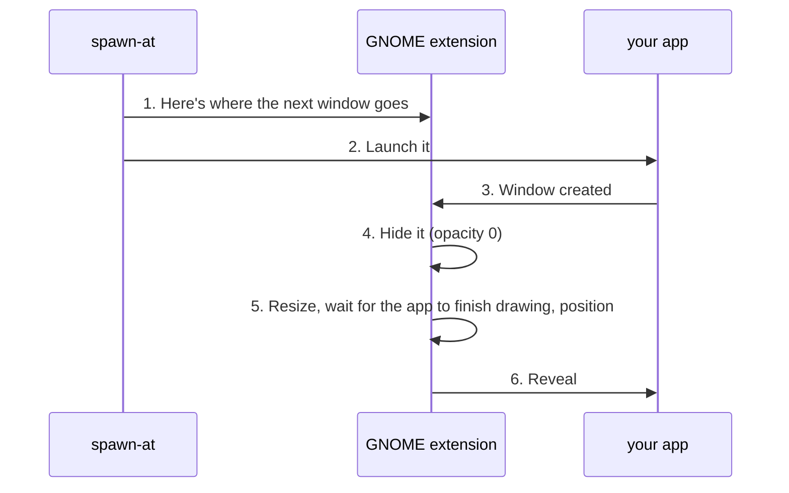
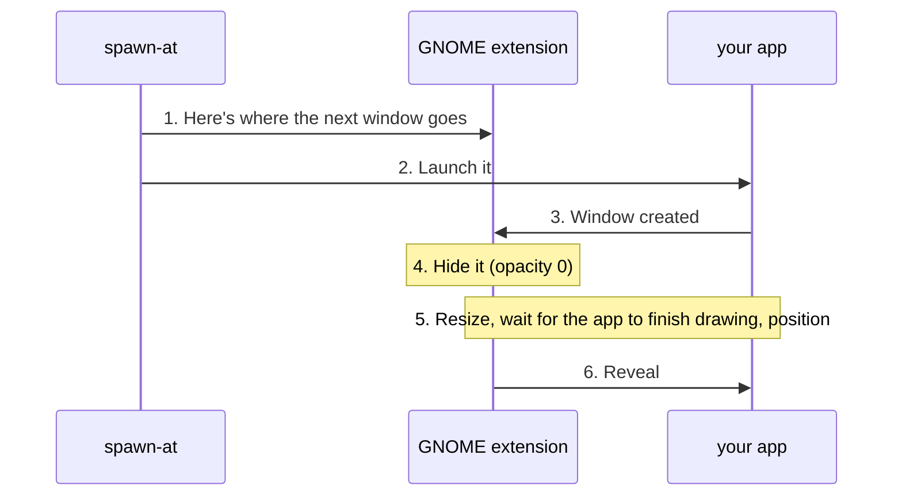

<h1 align="center">spawn-at</h1>

<p align="center">
  <a href="https://github.com/harshp2008/spawn-at/releases"></a>
  <a href="https://github.com/harshp2008/spawn-at/blob/main/Cargo.toml"></a>
  <a href="https://github.com/harshp2008/spawn-at/blob/main/LICENSE"></a>
</p>

**Every desktop places windows differently. That's why no window tool works everywhere.**

Want to open an app at an exact spot and size? On X11 you can move anything, but you'll watch it jump. On Wayland, apps can't place themselves and there's no standard way for anyone else to do it. Each compositor has its own answer, and macOS and Windows are their own worlds.

`spawn-at` is one command and one placement model, with a driver per desktop underneath. The only driver with cloaking today is GNOME Shell, and only GNOME 46 on Wayland has been tested in earnest. X11 and XWayland windows go through the same driver but keep the older, shorter wait, can still flash, and have been tried with the test window only. On GNOME Shell the window is kept invisible until it has been placed and (on Wayland) the app has had time to draw at the new size. That removes most flashes but not all of them: see [How well it works](#how-well-it-works).

<!-- TODO: demo gif: split screen. Left: sleep + xdotool script, window flashes at the default spot, then jumps. Right: spawn-at, window just appears in place. Same app, same target. -->

## Install

```bash
# v0.2.0 is in beta, so --prerelease is needed for now
curl -fsSL https://raw.githubusercontent.com/harshp2008/spawn-at/main/install.sh | bash -s -- --prerelease
```

Only GNOME Shell 46 on Wayland has been tested; see [Support](#support). On Wayland, log out and back in once so GNOME loads the extension (the installer asks last, and skips the question when the extension is unchanged and already running). On X11 the installer reloads the Shell in place and your apps stay open. On any other GNOME version the installer prints a notice first and asks before it installs (`--yes` skips the question). If spawn-at is already installed, an interactive install says where and which version and asks whether to upgrade in place (the default) or do a clean install; `--clean-install` does the clean install without asking and keeps your configuration. See [more install options](#more-install-options).

## The problem

| Environment | How you move a window | Catch |
| :--- | :--- | :--- |
| X11 | `xdotool`, `wmctrl` | Works, but only after the window is visible, so it flashes. |
| GNOME / Wayland | A Shell extension (JavaScript) | Apps can't position themselves. Only the compositor can. |
| Hyprland | `hyprctl` | Its own IPC and rule syntax. |
| Sway | `swaymsg` | A different IPC again. |
| KDE Plasma | KWin rules or scripts | Static rules, or KWin's own script API. |
| macOS | Accessibility API | Needs a permission grant, and Spaces get in the way. |
| Windows | Win32 calls | Works per window, but nothing places it before first paint. |

So every window tool ends up X11-only, tied to one compositor, or a pile of per-desktop scripts. Your launcher can't be portable, and your dotfiles break the day you switch desktops.

## What it looks like

The usual way to place a window:

```bash
gnome-terminal &
sleep 0.4                        # guess how long the window takes to appear
xdotool ... windowmove 1200 400 windowsize 700 450
```

The window opens in the wrong place, sits there, then jumps. On native Wayland, `xdotool` can't see it at all.

With spawn-at:

```bash
spawn-at spawn --anchor top-right --size 700 450 -m 24 gnome-terminal
```

It opens at the top-right of your workarea, 24px in from the edges, already sized. Nothing visible in between.

## Things I use it for

```bash
# Calculator popup under the mouse
spawn-at spawn --anchor cursor --pivot center --size 400 500 gnome-calculator

# Scratchpad terminal pinned to the top-right
spawn-at spawn --anchor top-right --pivot top-right --size 800 500 -m 20 alacritty

# Dashboard in the corner that doesn't steal your typing focus
spawn-at spawn --anchor bottom-right --size 600 350 -m 16 --no-focus btop
```

Bind any of these to a GNOME custom shortcut and you have instant floating tools.

It also works on windows that are already open:

```bash
spawn-at transform --class org.gnome.Calculator --anchor center --size 400 500
```

<!-- TODO: demo gif: two hotkeys back to back, calculator at the cursor then a scratchpad terminal at the edge. Both appear in place, no flash. -->

## How it works

Only the compositor can place windows on Wayland, so spawn-at ships a small GNOME Shell extension and talks to it over D-Bus.



Three details do most of the work:

- **Registered before launch.** The extension already knows what to do when the window appears, so there's no race between the window existing and us finding out about it.
- **It waits for the app, not just the compositor.** Resizing a frame doesn't mean the app has drawn into it. On GNOME 46 Wayland the extension waits until the app has answered the size request (default cap 250 ms, hard limit 1500 ms) before revealing. XWayland and X11 windows, and the legacy GNOME 42-44 extension, still use the old rule: a 30 ms quiet period, 120 ms minimum, 1500 ms hard cap.
- **A window never stays invisible.** Registrations expire after 15 seconds (1.2s for wildcard matches), unmatched windows are revealed immediately, and errors during placement restore opacity. If something goes wrong you get a normally placed window, not a ghost.

<details>
<summary>More internals</summary>

- **GNOME Terminal quirk.** GTK3/libvte terminals don't lay out their character grid until they get a keyboard focus change. The extension detects libvte via `/proc/<pid>/maps` and pulses focus while the window is still hidden. Other toolkits skip this.
- **Late resizes.** Right before the reveal, a resize that arrived late is corrected by re-anchoring, in up to two frame passes (GNOME 46 extension; the legacy 42-44 extension checks once). After the reveal the extension keeps a listener on the window's size changes: when the app resizes itself (font loading, client-side decorations) and the anchored position moves, the frame is moved back. The listener is dropped when the window closes, or one second after the last correction if the size then stays quiet. It does nothing while the window is maximized or fullscreen or while you are dragging it. A window that never needed a correction keeps the listener until it closes.
- **Concurrent spawns.** Requests go through a queue, so two hotkeys pressed together don't interleave their configure events.
- **Layout math.** Anchors, pivots, margins and clamping live in `spawn-at-core`, pure Rust with no display server dependency. Session type comes from `loginctl`, not `$XDG_SESSION_TYPE`.
- **Minimum-size handling.** An observation from development, not a tested guarantee (no document in this repo records it): GTK3 apps that end up larger than the requested size needed their own handling, and the first fix broke GTK4 apps. The documented minimum-size evidence is for the test window and for gnome-text-editor, zenity and firefox: see [docs/TEST_PLAN.md](docs/TEST_PLAN.md) sections 6.2 to 6.4.
</details>

## One CLI, a driver per desktop

The geometry model (10 anchors, 5 pivots, margins, workarea clamping) is shared. A driver only has to answer: where are the screens, where is the cursor, and how do I place and reveal a window.



Wayland is the worst case: no client-side placement, no global window API, and the compositor has to do everything. If one command can place a window with few or no flashes there, the same model should carry to the easier platforms.

## How well it works

Measured on one machine (GNOME 46, Wayland, one monitor, the project's own test window, not real apps), same login, runs alternating between the old rule and the new one:

- **Far fewer flashes in our measurements on GNOME 46 Wayland.** Under heavy CPU load (22 busy threads), the old rule flashed in 26 of 40 runs and the ready-wait in 0 of 40, judged by wire time. Idle, neither flashed in 20 runs.
- **Wire time is the optimistic bound.** A "flash" here means the window was revealed before the app's first commit at its final size, read from the Wayland protocol. It says nothing about what a compositor frame actually showed.
- **No screen capture was done.** Nobody measured pixels on screen.
- **Cost:** under load the window is hidden longer. The median was 45.3 ms (old rule) against 66.8 ms (new) in one measurement and 48.9 against 56.2 ms in a second one, so it varies between runs; idle there is no difference. In the second measurement 1 of 40 idle runs with the new rule hit the 250 ms cap (the app answered late); the cause is unknown.
- **XWayland, X11 and GNOME 42-44 still use the old rule**, and flash. Only the test window has been tried there, not real X11 apps.
- **An app already at its minimum size** (so it cannot answer a resize) makes the ready-wait run for the full `wait.cap_ms` (about +230 ms in our test). The same goes for an app that never answers (a hung one).

The numbers and method are in [docs/TEST_PLAN.md](docs/TEST_PLAN.md) (sections 6.22 and 6.23).

## Settings

`spawn-at config` shows and changes a few behaviours. Nothing needs to be set: with no config file and no flags `spawn-at` behaves exactly as before.

| Key | Default | Allowed | What it does |
| :--- | :--- | :--- | :--- |
| `wait.cap_ms` | not sent (the extension's own default: 250 ms from this release, 150 ms before) | whole milliseconds, 1 to 1500 | The longest the extension waits for an app to answer a size request before it shows the window anyway. |
| `wait.strategy` | `auto` | `auto`, `legacy`, `ready-wait` | Which rule waits for the resized window. `auto` lets the extension choose; `legacy` is the original 30 ms quiet rule; `ready-wait` is the newer wait on GNOME Wayland. |
| `spawn.window_timeout_ms` | 2000 | whole milliseconds, 200 to 60000 | How long `spawn` waits for the new window to appear before it warns that it did not (applies to the extension's claim and again to the fallback poll). |

```sh
spawn-at config                        # every setting, its value, and where the value comes from
spawn-at config set wait.cap_ms 400
spawn-at config get wait.cap_ms
spawn-at config unset wait.cap_ms      # back to the default
spawn-at config path                   # the file: $XDG_CONFIG_HOME/spawn-at/config.toml, or ~/.config/spawn-at/config.toml
spawn-at config reset                  # remove all of the settings above (update preferences and other keys stay)
```

A value on the command line beats the file, and the file beats the default; `show` names the source of each value (`default`, `file` or `flag`). A setting that is not set sends nothing to the extension. An unknown key in the file is a warning, a file that is not valid TOML is one warning with the line number, and in both cases `spawn` carries on with the defaults. Setting a key rewrites the file without comments. Set `SPAWN_AT_CONFIG=<path>` to use a different file (a path that does not exist means "no config").

**On a slow or busy machine:**
- Windows that still appear at the wrong size or jump just after they appear: raise `wait.cap_ms` (try 400). A longer cap costs nothing when the app answers in time; it only delays the window for an app that never answers. An app that is already at its minimum size is such an app: it costs the full cap on every spawn.
- `WARNING: ... did not appear within 2s` for a heavy app (a browser or an Electron app starting cold): raise `spawn.window_timeout_ms` (try 8000).
- To compare with the pre-0.2 behaviour: `spawn-at config set wait.strategy legacy`.

## Support

Only one configuration has been tested. **X11 and the legacy GNOME 42-44 extension have not been thoroughly tested**, and everything marked untested below may not work. Bug reports are welcome: [issues](https://github.com/harshp2008/spawn-at/issues).

| Environment | Status |
| :--- | :--- |
| GNOME 46, Wayland session | **Tested** |
| GNOME 46, X11 session | Partly tested (the test fixture only, no real apps) |
| XWayland windows (X11 apps on a Wayland session) | Test window only, no real apps. Uses the old rule, so it flashes more |
| GNOME 42, 43, 44 (the legacy extension) | **Untested**: never run on a real GNOME 42-44, it may not work at all |
| GNOME 45 and 47+ | Untested (the extension's metadata lists 45 to 48, but only 46 has been run) |
| Multi-monitor, fractional scaling | Untested |
| Real GTK apps | A few runs each, Wayland only: gnome-text-editor and nautilus (GTK4), gnome-terminal, zenity and firefox (snap), which we believe are GTK3 (the toolkit version was not checked). Firefox flashed in 6 of 6 runs under the old rule (TEST_PLAN 6.12). Chrome was never matched |
| Qt and Electron apps | Untested |
| Other X11 desktops | Experimental native driver, untested. No cloaking, so you'll see the flash. |
| Sway (**experimental**, opt-in with `SPAWN_AT_BACKEND=sway`, see [below](#sway-experimental)) | Run only against a private headless Sway 1.9 with the test window: no real Sway session, no real apps, and a window can flash once |
| Hyprland, KDE, macOS, Windows | Not implemented |

On an untested GNOME version the installer prints this before it installs anything and asks you to confirm; in a headless or non-interactive run it prints the notice and goes on. Apps that refuse a requested size can still end up larger than you asked for, but they're positioned using their final size, so anchors land correctly.

**X11/XWayland: investigated, no reliable signal.** We looked for a way to tell when an X11 client has painted at its new size and tried several signals on the test window. Most were not usable. The only leads are narrow: the X sync counter works as an experimental signal for GTK4-style clients only, and an `LD_PRELOAD` shim made one GTK4 test client map at the target size on one machine, with security and compatibility costs. No screen-capture measurement of what is visible has been made. **None of this ships in 0.2.0-beta.1, 0.2.0-beta.2, 0.2.0-beta.3 or 0.2.0-beta.4:** XWayland and X11 windows keep the old 30 ms rule and can still flash. Every number, what was tried and the caveats are in [docs/TEST_PLAN.md](docs/TEST_PLAN.md) 6.23 to 6.35 and [docs/DESIGN_READY_WAIT.md](docs/DESIGN_READY_WAIT.md) sections 12 to 15.

## Sway (experimental)

An opt-in backend for [Sway](https://swaywm.org/) that talks to its IPC socket. It is **never chosen automatically**: a Sway session without the variable below still gets the X11 backend, as before. Nothing needs installing; `spawn-at install` has nothing to do for it.

```bash
# inside a Sway session ($SWAYSOCK is set by Sway)
SPAWN_AT_BACKEND=sway spawn-at spawn --anchor top-right -m 24 --size 600 400 -- foot
# in the Sway config
bindsym $mod+Shift+Return exec env SPAWN_AT_BACKEND=sway spawn-at spawn --anchor center -- foot
```

If `SPAWN_AT_BACKEND=sway` is set and `$SWAYSOCK` is missing, empty or not a Sway socket, spawn-at stops with an error that names `$SWAYSOCK`; it does not fall back to X11.

What works: `spawn` with anchors, margins, `--size` and `--monitor <index>` (the default work area; `--area screen` and `unbounded` were not tried); `query layout`, `query windows`, `transform`, `close`, `focus`. Windows are made floating and placed with the same layout math as on GNOME. `--size` is the size of the whole window including its border and title bar, as on GNOME; a window cannot be made smaller than Sway lets it (75x50 for a floating window in the one setup tried), and then it is placed using the size it ended up with.

What is different or missing:
- **It can flash.** Sway has no way to keep a new window invisible until it is placed, so the window may show for one frame at its tiled position first. That has not been measured.
- Not supported: `--anchor cursor` and `--monitor cursor` (Sway has no pointer query), maximize, minimize and defocus. `--monitor` counts outputs in the order Sway lists them; monitor 0 is reported as primary because Sway has none.
- A window is matched to the launched process by pid, then by parent process, then by app id. If none shows up within 5 seconds spawn-at warns that the application was started but not placed, and moves nothing else.
- i3 is not supported.

Tested: a private headless Sway 1.9 and the repo's own test window, with `scripts/sway-live.sh` (one output, then a scale-2 output with a bar plus a second output). Not tested: a real Sway session, real applications, XWayland windows, any other Sway version, frame timing. Design and measurements: [docs/DESIGN_SWAY.md](docs/DESIGN_SWAY.md).

## Roadmap

v0.2.0-beta.4 restructures the code for other platforms and adds an experimental, opt-in Sway backend; it changes no GNOME placement behavior. Groundwork for other platforms is still to come. No dates and no promises: other compositors (Hyprland, KDE) are not implemented, Sway is experimental and opt-in, and support only gets claimed for an environment once its live test suite passes there. Ideas for choosing the wait method per app are in [docs/DESIGN_READY_WAIT.md](docs/DESIGN_READY_WAIT.md) section 15; they need real-app testing that has not been done.

## Contributing a backend

Compositors sit behind the `CompositorBackend` trait in [`src/platform/mod.rs`](src/platform/mod.rs). The core of it:

```rust
pub trait CompositorBackend: Driver + Send + Sync {
    fn name(&self) -> &'static str;
    async fn get_cursor_position(&self) -> Result<(i32, i32), DriverError>;
    async fn get_workareas(&self) -> Result<Vec<Rect>, DriverError>;
    async fn transform_window(&self, target_id: &str, params: PlacementParams, w: u32, h: u32) -> Result<(), DriverError>;
    // ...plus focus, state, query and post_spawn methods
}
```

Add a module under `src/platform/linux/` and register it in `LinuxBackend::bootstrap()`.

## More install options

```bash
# Pin a version
curl -fsSL https://raw.githubusercontent.com/harshp2008/spawn-at/main/install.sh | bash -s -- --version v0.2.0-beta.4

# Skip the confirmation shown on an untested GNOME version (the notice is still printed)
curl -fsSL https://raw.githubusercontent.com/harshp2008/spawn-at/main/install.sh | bash -s -- --yes

# Remove an existing install (binary, extension, login update check) first, without asking; your config and settings are kept
curl -fsSL https://raw.githubusercontent.com/harshp2008/spawn-at/main/install.sh | bash -s -- --clean-install

# Headless
curl -fsSL https://raw.githubusercontent.com/harshp2008/spawn-at/main/install.sh | bash -s -- --headless --scope user

# From source
git clone https://github.com/harshp2008/spawn-at.git && cd spawn-at
cargo build --release && ./target/release/spawn-at install
```

<details>
<summary><strong>CLI reference</strong></summary>

Run `spawn-at --help` or `spawn-at <command> --help` for the full list.

| Command | Description |
| :--- | :--- |
| `spawn <cmd...>` | Pre-arm geometry and launch a new app (`--json` outputs single structured result object on stdout). |
| `transform` | Reposition and resize an already-open window. |
| `focus` / `defocus` | Raise a window, or give focus away (`--to-desktop`, `--to-window <ID>`). |
| `maximize` / `minimize` / `restore` | Change window state. |
| `close` | Request graceful closure of a target window. |
| `query layout\|pointer\|windows` | Print monitors, cursor position, or open windows (`query windows` reports `GEOMETRY` in global screen coordinates, and a maximized window sits at the work area's origin). `--json` on layout and windows. |
| `install` / `uninstall` | Manage the binary and the GNOME Shell extension. |
| `update` | Check for or apply releases (`--check`, `--channel stable\|beta`, `--force`). `beta` also offers pre-releases; `all` is a deprecated alias of `beta`. |

| Group | Flag | Description |
| :--- | :--- | :--- |
| **Reference area** | `--area` | `workarea` (default), `screen`, or `unbounded`. Sets the reference boundary and coordinate space for positions, anchors, margins, and clamping. |
| | `--monitor` | Monitor index, `cursor`, or `primary` (default). |
| **Anchor and pivot** | `--anchor` | `center`, `top-left`, `top-right`, `bottom-left`, `bottom-right`, `top`, `bottom`, `left`, `right`, `cursor` (cursor defaults to `top-left` pivot). |
| | `--pivot` | Which point of the window sits on the anchor: `center`, `top-left`, `top-right`, `bottom-left`, `bottom-right`. |
| **Position and size** | `-p, --pos <X> <Y>` / `-o, --offset <X> <Y>` | Absolute position in pixels within the chosen area, or offset from anchor when `--anchor` is specified (aliases for the same option). |
| | `-s, --size <W> <H>` | Window size in pixels. |
| **Bounds** | `--clamp <true\|false>` | Keeps the window inside the chosen area minus the margin (default true; rejected with `--area unbounded`). |
| | `-m, --margin <PX>` | Universal margin in pixels (default 16; rejected with `--area unbounded`). |
| | `--mt`, `--mb`, `--ml`, `--mr` | Per-side margins. |
| **Behavior** | `--focus` / `--no-focus` / `--defocus` | Control focus after the action. |
| | `--json` | Output single structured JSON object on stdout (`spawn`, `query layout`, `query windows`). Diagnostics stay on stderr. |
| | `--no-wait` | Exit without waiting for the compositor. |
| **Target & command** | `--id` / `-c, --class` / `-t, --title` / `--pid` / `--focused` | Pick which window to act on (`--id` matches exact numeric ID from `query windows`). |
| | `<COMMAND>...` | Command to spawn along with any trailing flags/arguments. |

### Coordinate Model

`--area` sets the coordinate space; `--anchor` / `--pivot` choose the reference point; `-p` / `-o` is the offset/position; `--clamp`, `-m`, and `--mt`/`--mb`/`--ml`/`--mr` bound the result.

- **`--area workarea` (default)**: The usable work area of the target monitor (excluding top bar, docks, panels). `-p` / `-o` is relative to that area's raw top-left corner `(wa.x, wa.y)`. Clamped inside the work area minus margins.
- **`--area screen`**: The full physical rectangle of the target monitor `(screen.x, screen.y)`. `-p` / `-o` is relative to that monitor's raw top-left corner. Clamped inside the screen rectangle minus margins.
- **`--area unbounded`**: The global desktop layout across all monitors (the exact same coordinate space as `GEOMETRY` in `query windows`). `-p` / `-o` are absolute global coordinates. No margin, no border, and no clamp.
  - Allowed with `unbounded`: `-p` / `-o`, `--pivot`, `--size`, `--anchor cursor`.
  - Rejected with a clear error: any other `--anchor`, `--clamp`, `-m` / `--mt` / `--mb` / `--ml` / `--mr`, `--monitor`.
  - Windows straddling monitors are allowed by Mutter; `spawn-at` prints an `INFO` diagnostic naming the straddled monitors without modifying coordinates.

#### Concrete Examples

Assuming a display with screen `1920x1080@(0,0)`, work area `1920x1040@(0,40)` (top bar height 40px), and default margin 16:
- `spawn-at spawn -p 700 300 app` &rarr; screen `(700, 340)` (offset relative to work area top-left `(0, 40)`).
- `spawn-at spawn --area screen -p 700 300 app` &rarr; screen `(700, 300)` (offset relative to screen top-left `(0, 0)`).
- `spawn-at spawn --area unbounded -p 700 300 app` &rarr; screen `(700, 300)` (absolute desktop coordinate).
- `spawn-at spawn -p 0 0 app` &rarr; screen `(16, 56)` (requested `(0, 0)` in work area; clamped to margin `16px` &rarr; `(0+16, 40+16)`).

#### `-p` vs Anchors

- **Without `--anchor`**: The reference point is the area's **raw top-left corner** (no margin added to the requested position). Margins still define the clamping boundary. Default pivot is `top-left`.
- **With `--anchor`**: Anchor points include margins (e.g. `top-left` anchor is positioned at `(wa.x + ml, wa.y + mt)`). `-p` / `-o` acts as an offset from that anchored reference point.
- **`--pivot`**: Defines which point of the window aligns with the target position or anchor (`top-left`, `top-right`, `bottom-left`, `bottom-right`, `center`).

Centering and rounding rule: Centering along an axis is computed as `origin + floor((area_size - window_size) / 2)`. An odd remainder puts the extra pixel on the right/bottom.

Placement defaults: A window moves only when requested.
- Neither `--anchor` nor `-p`/`-o` given: no move instruction is sent. With `--size` alone: resize only (on transform the window keeps its top-left; on spawn the app opens where it opens, resized).
- `-p` / `-o` without `--anchor`: position relative to the reference area; pivot defaults to `top-left`.
- `-p` / `-o` with `--anchor`: offset from the anchor point.
- `--pivot` without `--anchor` and without `-p`/`-o` on `transform`: resize around that point of the window (center keeps center fixed, bottom-right keeps that corner fixed); no move otherwise.
- Default pivots: When `--pivot` is omitted, each anchor defaults to its matching alignment point (`center` -> `center`, `top` -> top-center, `bottom` -> bottom-center, `left` -> left-center, `right` -> right-center, corners -> matching corner, `cursor` -> `top-left`).
- Clamping applies by default after any move or resize (if the result leaves the area, clamped inside with an INFO note; `--clamp false` disables).

Margins and centering: Edge and center anchors center along their axis relative to the **whole reference area** (not the margin-inset area). Directional margins (`--mt`, `--mb`, `--ml`, `--mr`) offset the anchored boundary edge. Clamping subsequently enforces all directional margins if the window dimensions exceed the available inset bounds.

</details>

## License

MIT. See [LICENSE](LICENSE).