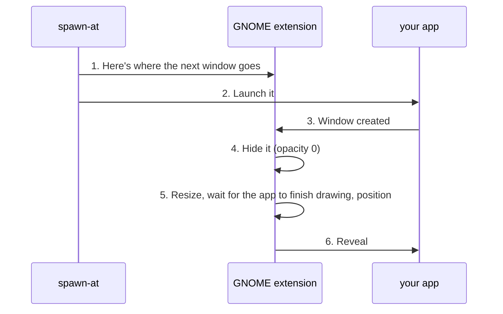
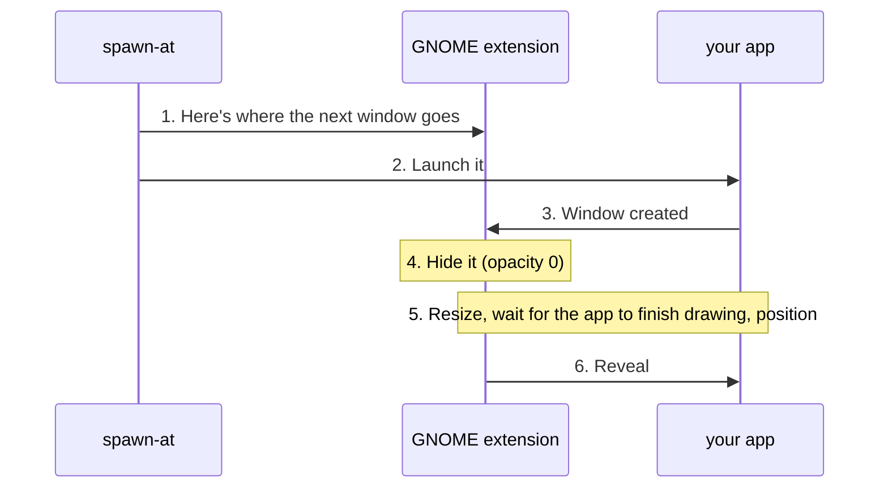

<h1 align="center">spawn-at</h1>

<p align="center">
  <a href="https://github.com/harshp2008/spawn-at/releases"></a>
  <a href="https://github.com/harshp2008/spawn-at/blob/main/Cargo.toml"></a>
  <a href="https://github.com/harshp2008/spawn-at/blob/main/LICENSE"></a>
</p>

**Every desktop places windows differently. That's why no window tool works everywhere.**

Want to open an app at an exact spot and size? On X11 you can move anything, but you'll watch it jump. On Wayland, apps can't place themselves and there's no standard way for anyone else to do it. Each compositor has its own answer, and macOS and Windows are their own worlds.

`spawn-at` is one command and one placement model, with a driver per desktop underneath. The finished driver today is GNOME Shell, on both Wayland and X11. The window stays invisible until it's exactly where you asked.

<!-- TODO: demo gif: split screen. Left: sleep + xdotool script, window flashes at the default spot, then jumps. Right: spawn-at, window just appears in place. Same app, same target. -->

## Install

```bash
# v0.2.0 is in beta, so --prerelease is needed for now
curl -fsSL https://raw.githubusercontent.com/harshp2008/spawn-at/main/install.sh | bash -s -- --prerelease
```

Tested on Ubuntu with GNOME Shell, on both Wayland and X11. On Wayland, log out and back in once so GNOME loads the extension. On X11 the installer reloads the Shell in place and your apps stay open. See [more install options](#more-install-options).

## The problem

| Environment | How you move a window | Catch |
| :--- | :--- | :--- |
| X11 | `xdotool`, `wmctrl` | Works, but only after the window is visible, so it flashes. |
| GNOME / Wayland | A Shell extension (JavaScript) | Apps can't position themselves. Only the compositor can. |
| Hyprland | `hyprctl` | Its own IPC and rule syntax. |
| Sway | `swaymsg` | A different IPC again. |
| KDE Plasma | KWin rules or scripts | Static rules, or KWin's own script API. |
| macOS | Accessibility API | Needs a permission grant, and Spaces get in the way. |
| Windows | Win32 calls | Works per window, but nothing places it before first paint. |

So every window tool ends up X11-only, tied to one compositor, or a pile of per-desktop scripts. Your launcher can't be portable, and your dotfiles break the day you switch desktops.

## What it looks like

The usual way to place a window:

```bash
gnome-terminal &
sleep 0.4                        # guess how long the window takes to appear
xdotool ... windowmove 1200 400 windowsize 700 450
```

The window opens in the wrong place, sits there, then jumps. On native Wayland, `xdotool` can't see it at all.

With spawn-at:

```bash
spawn-at spawn --anchor top-right --size 700 450 -m 24 gnome-terminal
```

It opens at the top-right of your workarea, 24px in from the edges, already sized. Nothing visible in between.

## Things I use it for

```bash
# Calculator popup under the mouse
spawn-at spawn --anchor cursor --pivot center --size 400 500 gnome-calculator

# Scratchpad terminal pinned to the top-right
spawn-at spawn --anchor top-right --pivot top-right --size 800 500 -m 20 alacritty

# Dashboard in the corner that doesn't steal your typing focus
spawn-at spawn --anchor bottom-right --size 600 350 -m 16 --no-focus btop
```

Bind any of these to a GNOME custom shortcut and you have instant floating tools.

It also works on windows that are already open:

```bash
spawn-at transform --class org.gnome.Calculator --anchor center --size 400 500
```

<!-- TODO: demo gif: two hotkeys back to back, calculator at the cursor then a scratchpad terminal at the edge. Both appear in place, no flash. -->

## How it works

Only the compositor can place windows on Wayland, so spawn-at ships a small GNOME Shell extension and talks to it over D-Bus.



Three details do most of the work:

- **Registered before launch.** The extension already knows what to do when the window appears, so there's no race between the window existing and us finding out about it.
- **It waits for the app, not just the compositor.** Resizing a frame doesn't mean the app has drawn into it. The extension watches the app's buffer settle (30ms quiet period, 120ms minimum, 1500ms hard cap) before revealing.
- **A window never stays invisible.** Registrations expire after 15 seconds (1.2s for wildcard matches), unmatched windows are revealed immediately, and errors during placement restore opacity. If something goes wrong you get a normally placed window, not a ghost.

<details>
<summary>More internals</summary>

- **GNOME Terminal quirk.** GTK3/libvte terminals don't lay out their character grid until they get a keyboard focus change. The extension detects libvte via `/proc/<pid>/maps` and pulses focus while the window is still hidden. Other toolkits skip this.
- **Late resizes.** If an app resizes itself after reveal (font loading, client-side decorations), a 1-second listener re-applies your anchor so the window doesn't drift.
- **Concurrent spawns.** Requests go through a queue, so two hotkeys pressed together don't interleave their configure events.
- **Layout math.** Anchors, pivots, margins and clamping live in `spawn-at-core`, pure Rust with no display server dependency. Session type comes from `loginctl`, not `$XDG_SESSION_TYPE`.
- **Minimum-size handling.** GTK3 apps that violate the requested size needed their own handling, and
  the fix for that initially broke GTK4, so both paths are covered now.
</details>

## One CLI, a driver per desktop

The geometry model (10 anchors, 5 pivots, margins, workarea clamping) is shared. A driver only has to answer: where are the screens, where is the cursor, and how do I place and reveal a window.



Wayland is the worst case: no client-side placement, no global window API, and the compositor has to do everything. If one command can place a window with no flash there, the same model should carry to the easier platforms.

## Settings

`spawn-at config` shows and changes a few behaviours. Nothing needs to be set: with no config file and no flags `spawn-at` behaves exactly as before.

| Key | Default | Allowed | What it does |
| :--- | :--- | :--- | :--- |
| `wait.cap_ms` | not sent (the extension's own default: 250 ms from this release, 150 ms before) | whole milliseconds, 1 to 1500 | The longest the extension waits for an app to answer a size request before it shows the window anyway. |
| `wait.strategy` | `auto` | `auto`, `legacy`, `ready-wait` | Which rule waits for the resized window. `auto` lets the extension choose; `legacy` is the original 30 ms quiet rule; `ready-wait` is the newer wait on GNOME Wayland. |
| `spawn.window_timeout_ms` | 2000 | whole milliseconds, 200 to 60000 | How long `spawn` waits for the new window to appear before it warns that it did not (applies to the extension's claim and again to the fallback poll). |

```sh
spawn-at config                        # every setting, its value, and where the value comes from
spawn-at config set wait.cap_ms 400
spawn-at config get wait.cap_ms
spawn-at config unset wait.cap_ms      # back to the default
spawn-at config path                   # the file: $XDG_CONFIG_HOME/spawn-at/config.toml, or ~/.config/spawn-at/config.toml
spawn-at config reset                  # remove all of the settings above (update preferences and other keys stay)
```

A value on the command line beats the file, and the file beats the default; `show` names the source of each value (`default`, `file` or `flag`). A setting that is not set sends nothing to the extension. An unknown key in the file is a warning, a file that is not valid TOML is one warning with the line number, and in both cases `spawn` carries on with the defaults. Setting a key rewrites the file without comments. Set `SPAWN_AT_CONFIG=<path>` to use a different file (a path that does not exist means "no config").

**On a slow or busy machine:**
- Windows that still appear at the wrong size or jump just after they appear: raise `wait.cap_ms` (try 400). A longer cap costs nothing when the app answers in time; it only delays the window for an app that never answers.
- `WARNING: ... did not appear within 2s` for a heavy app (a browser or an Electron app starting cold): raise `spawn.window_timeout_ms` (try 8000).
- To compare with the pre-0.2 behaviour: `spawn-at config set wait.strategy legacy`.

## Status

| Environment | Status |
| :--- | :--- |
| Ubuntu, GNOME Shell on Wayland | Tested |
| Ubuntu, GNOME Shell on X11 | Tested |
| Other GNOME-based desktops | Should work (same extension), untested |
| Other X11 desktops | Experimental native driver. No cloaking, so you'll see the flash. |
| Hyprland, Sway, KDE, macOS, Windows | Not implemented |

The extension declares GNOME Shell 45 to 48 in its metadata. Tested on: Ubuntu `<version>`, GNOME Shell `<version>` (fill in from `gnome-shell --version`).

Toolkit coverage: GTK3 and GTK4 apps are tested (6 apps so far), including apps that enforce a minimum
window size. Electron and Qt apps should work but haven't been tested yet. Apps that refuse a requested
size can still end up larger than you asked for, but they're positioned using their final size, so
anchors land correctly.

## Roadmap

Next up: `<pick one: Hyprland / Sway / KDE>`. After that: the rest of the planned drivers. Support only gets claimed for an environment once its live test suite passes there.

## Contributing a backend

Compositors sit behind the `CompositorBackend` trait in [`src/platform/mod.rs`](src/platform/mod.rs). The core of it:

```rust
pub trait CompositorBackend: Driver + Send + Sync {
    fn name(&self) -> &'static str;
    async fn get_cursor_position(&self) -> Result<(i32, i32), DriverError>;
    async fn get_workareas(&self) -> Result<Vec<Rect>, DriverError>;
    async fn transform_window(&self, target_id: &str, params: PlacementParams, w: u32, h: u32) -> Result<(), DriverError>;
    // ...plus focus, state, query and post_spawn methods
}
```

Add a module under `src/platform/linux/` and register it in `LinuxBackend::bootstrap()`.

## More install options

```bash
# Pin a version
curl -fsSL https://raw.githubusercontent.com/harshp2008/spawn-at/main/install.sh | bash -s -- --version v0.2.0-beta

# Headless
curl -fsSL https://raw.githubusercontent.com/harshp2008/spawn-at/main/install.sh | bash -s -- --headless --scope user

# From source
git clone https://github.com/harshp2008/spawn-at.git && cd spawn-at
cargo build --release && ./target/release/spawn-at install
```

<details>
<summary><strong>CLI reference</strong></summary>

Run `spawn-at --help` or `spawn-at <command> --help` for the full list.

| Command | Description |
| :--- | :--- |
| `spawn <cmd...>` | Pre-arm geometry and launch a new app (`--json` outputs single structured result object on stdout). |
| `transform` | Reposition and resize an already-open window. |
| `focus` / `defocus` | Raise a window, or give focus away (`--to-desktop`, `--to-window <ID>`). |
| `maximize` / `minimize` / `restore` | Change window state. |
| `close` | Request graceful closure of a target window. |
| `query layout\|pointer\|windows` | Print monitors, cursor position, or open windows (`query windows` reports `GEOMETRY` in global screen coordinates, and a maximized window sits at the work area's origin). `--json` on layout and windows. |
| `install` / `uninstall` | Manage the binary and the GNOME Shell extension. |
| `update` | Check for or apply releases (`--check`, `--channel`, `--force`). |

| Group | Flag | Description |
| :--- | :--- | :--- |
| **Reference area** | `--area` | `workarea` (default), `screen`, or `unbounded`. Sets the reference boundary and coordinate space for positions, anchors, margins, and clamping. |
| | `--monitor` | Monitor index, `cursor`, or `primary` (default). |
| **Anchor and pivot** | `--anchor` | `center`, `top-left`, `top-right`, `bottom-left`, `bottom-right`, `top`, `bottom`, `left`, `right`, `cursor` (cursor defaults to `top-left` pivot). |
| | `--pivot` | Which point of the window sits on the anchor: `center`, `top-left`, `top-right`, `bottom-left`, `bottom-right`. |
| **Position and size** | `-p, --pos <X> <Y>` / `-o, --offset <X> <Y>` | Absolute position in pixels within the chosen area, or offset from anchor when `--anchor` is specified (aliases for the same option). |
| | `-s, --size <W> <H>` | Window size in pixels. |
| **Bounds** | `--clamp <true\|false>` | Keeps the window inside the chosen area minus the margin (default true; rejected with `--area unbounded`). |
| | `-m, --margin <PX>` | Universal margin in pixels (default 16; rejected with `--area unbounded`). |
| | `--mt`, `--mb`, `--ml`, `--mr` | Per-side margins. |
| **Behavior** | `--focus` / `--no-focus` / `--defocus` | Control focus after the action. |
| | `--json` | Output single structured JSON object on stdout (`spawn`, `query layout`, `query windows`). Diagnostics stay on stderr. |
| | `--no-wait` | Exit without waiting for the compositor. |
| **Target & command** | `--id` / `-c, --class` / `-t, --title` / `--pid` / `--focused` | Pick which window to act on (`--id` matches exact numeric ID from `query windows`). |
| | `<COMMAND>...` | Command to spawn along with any trailing flags/arguments. |

### Coordinate Model

`--area` sets the coordinate space; `--anchor` / `--pivot` choose the reference point; `-p` / `-o` is the offset/position; `--clamp`, `-m`, and `--mt`/`--mb`/`--ml`/`--mr` bound the result.

- **`--area workarea` (default)**: The usable work area of the target monitor (excluding top bar, docks, panels). `-p` / `-o` is relative to that area's raw top-left corner `(wa.x, wa.y)`. Clamped inside the work area minus margins.
- **`--area screen`**: The full physical rectangle of the target monitor `(screen.x, screen.y)`. `-p` / `-o` is relative to that monitor's raw top-left corner. Clamped inside the screen rectangle minus margins.
- **`--area unbounded`**: The global desktop layout across all monitors (the exact same coordinate space as `GEOMETRY` in `query windows`). `-p` / `-o` are absolute global coordinates. No margin, no border, and no clamp.
  - Allowed with `unbounded`: `-p` / `-o`, `--pivot`, `--size`, `--anchor cursor`.
  - Rejected with a clear error: any other `--anchor`, `--clamp`, `-m` / `--mt` / `--mb` / `--ml` / `--mr`, `--monitor`.
  - Windows straddling monitors are allowed by Mutter; `spawn-at` prints an `INFO` diagnostic naming the straddled monitors without modifying coordinates.

#### Concrete Examples

Assuming a display with screen `1920x1080@(0,0)`, work area `1920x1040@(0,40)` (top bar height 40px), and default margin 16:
- `spawn-at spawn -p 700 300 app` &rarr; screen `(700, 340)` (offset relative to work area top-left `(0, 40)`).
- `spawn-at spawn --area screen -p 700 300 app` &rarr; screen `(700, 300)` (offset relative to screen top-left `(0, 0)`).
- `spawn-at spawn --area unbounded -p 700 300 app` &rarr; screen `(700, 300)` (absolute desktop coordinate).
- `spawn-at spawn -p 0 0 app` &rarr; screen `(16, 56)` (requested `(0, 0)` in work area; clamped to margin `16px` &rarr; `(0+16, 40+16)`).

#### `-p` vs Anchors

- **Without `--anchor`**: The reference point is the area's **raw top-left corner** (no margin added to the requested position). Margins still define the clamping boundary. Default pivot is `top-left`.
- **With `--anchor`**: Anchor points include margins (e.g. `top-left` anchor is positioned at `(wa.x + ml, wa.y + mt)`). `-p` / `-o` acts as an offset from that anchored reference point.
- **`--pivot`**: Defines which point of the window aligns with the target position or anchor (`top-left`, `top-right`, `bottom-left`, `bottom-right`, `center`).

Centering and rounding rule: Centering along an axis is computed as `origin + floor((area_size - window_size) / 2)`. An odd remainder puts the extra pixel on the right/bottom.

Placement defaults: A window moves only when requested.
- Neither `--anchor` nor `-p`/`-o` given: no move instruction is sent. With `--size` alone: resize only (on transform the window keeps its top-left; on spawn the app opens where it opens, resized).
- `-p` / `-o` without `--anchor`: position relative to the reference area; pivot defaults to `top-left`.
- `-p` / `-o` with `--anchor`: offset from the anchor point.
- `--pivot` without `--anchor` and without `-p`/`-o` on `transform`: resize around that point of the window (center keeps center fixed, bottom-right keeps that corner fixed); no move otherwise.
- Default pivots: When `--pivot` is omitted, each anchor defaults to its matching alignment point (`center` -> `center`, `top` -> top-center, `bottom` -> bottom-center, `left` -> left-center, `right` -> right-center, corners -> matching corner, `cursor` -> `top-left`).
- Clamping applies by default after any move or resize (if the result leaves the area, clamped inside with an INFO note; `--clamp false` disables).

Margins and centering: Edge and center anchors center along their axis relative to the **whole reference area** (not the margin-inset area). Directional margins (`--mt`, `--mb`, `--ml`, `--mr`) offset the anchored boundary edge. Clamping subsequently enforces all directional margins if the window dimensions exceed the available inset bounds.

</details>

## License

MIT. See [LICENSE](LICENSE).