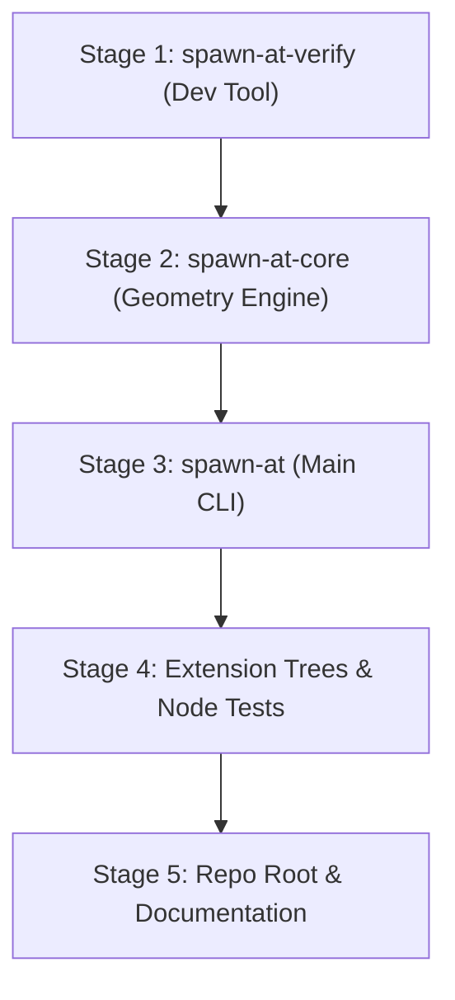

# spawn-at Codebase Reorganization & Architecture Layout Plan

> **PROPOSAL SPECIFICATION ONLY**  
> *Target Branch:* `refactor/v0.2.0-beta.1`  
> *Status:* Proposed Architecture (Pending Owner Review)  
> *Author:* Antigravity AI Assistant  
> *Date:* 2026-10-11  

---

## 1. Executive Summary & Goals

This document proposes a comprehensive codebase reorganization for the `spawn-at` repository. As the project has matured through the `v0.2.0-beta.1` refactor—adding extensive automated verification, mathematical placement oracles, compositor trace analyzers, interactive TUI harnesses, and multi-version GNOME Shell integration—several core files have grown far beyond maintainable thresholds (reaching up to ~3,500 lines).

### Core Architectural Goals
1. **Clean, Well-Organized Directory Structure:** A directory-per-concept hierarchy with no generic dumping grounds (`utils`, `helpers`, `misc`, `common`). Every folder represents a single domain concept.
2. **Strict File Size Budgets:**
   - **Target File Size:** 150 – 400 lines per file.
   - **Hard Cap:** 600 lines maximum for both production code and integration tests (any exception must be explicitly justified).
   - `lib.rs`, `main.rs`, and `mod.rs` files contain only declarations, re-exports, and top-level wiring.
3. **Single Responsibility Principle:** Each file has one focused responsibility (e.g. separate layout calculation from widget rendering; separate TUI state management from input handling and clipboard I/O).
4. **Heavily Commented Code ("Dense" Standard):** Mandatory top-level module documentation, doc comments on every declaration, block-level rationale, and explanations of all protocol quirks and mathematical formulas.
5. **Zero Behavior Regressions:** Pure file-level moves and modularizations with no semantic changes, identical CLI flags, unchanged test counts, and byte-identical golden output files.

---

## 2. Step 1: Codebase Inventory

### 2.1. Repository Root Tree (Depth 3)
*(Excluding `target/`, `node_modules/`, `verify-results/`, `.git/`)*

```text
.
├── .agent_notes
│   ├── 00_survey.md
│   ├── 01_findings.md
│   ├── 02_reconciliation.md
│   ├── 03_target_architecture.md
│   ├── 04_work_plan.md
│   └── readme-angles.md
├── .github
│   └── workflows
│       └── release.yml
├── .gitignore
├── AI_DEV
│   ├── spawn-at_master_architecture_blueprint.md
│   └── system_survey_and_understanding.md
├── CONTRIBUTING.md
├── Cargo.lock
├── Cargo.toml
├── LICENSE
├── README.md
├── assets
│   └── gnome
│       ├── legacy
│       └── modern
├── build.rs
├── crates
│   ├── spawn-at-core
│   │   ├── Cargo.toml
│   │   ├── src
│   │   └── tests
│   └── spawn-at-verify
│       ├── Cargo.toml
│       ├── THIRD_PARTY_NOTICES.md
│       ├── src
│       └── tests
├── docs
│   ├── TEST_PLAN.md
│   ├── behavior-notes.md
│   └── legacy-gnome.md
├── install.sh
├── scripts
│   └── smoke-live.sh
├── src
│   ├── cli
│   │   ├── args.rs
│   │   ├── mod.rs
│   │   └── tests.rs
│   ├── commands
│   │   ├── focus.rs
│   │   ├── lifecycle.rs
│   │   ├── mod.rs
│   │   ├── query.rs
│   │   ├── spawn.rs
│   │   └── transform.rs
│   ├── config.rs
│   ├── diagnostics.rs
│   ├── main.rs
│   ├── platform
│   │   ├── escalate.rs
│   │   ├── installer.rs
│   │   ├── linux
│   │   └── mod.rs
│   ├── target.rs
│   └── update.rs
├── tests
│   ├── cloak_test.js
│   ├── dispatcher_test.js
│   ├── extension_test.js
│   ├── gi_loader.js
│   ├── golden_anchor_test.js
│   └── legacy_dispatcher_test.js
└── verify
    ├── README.md
    ├── apps
    │   └── README.md
    ├── cloak
    │   ├── README.md
    │   └── delayed-paint.toml
    ├── diagnostics
    │   └── README.md
    ├── golden
    │   └── placement.json
    ├── launchers
    │   └── README.md
    ├── lifecycle
    │   └── README.md
    ├── placement
    │   ├── README.md
    │   └── bottom-right.toml
    ├── preflight
    │   ├── README.md
    │   └── binary-head.toml
    ├── query
    │   └── README.md
    ├── regression
    │   └── README.md
    ├── resilience
    │   └── README.md
    ├── suites
    │   ├── README.md
    │   ├── full.toml
    │   ├── quick.toml
    │   ├── regression.toml
    │   ├── release-gate.toml
    │   └── visual.toml
    └── transform
        └── README.md
```

---

### 2.2. Rust Source Files Inventory

| File Path | Lines | One-Line Responsibility | Top-Level Items (Names Only) | Flags |
| :--- | :---: | :--- | :--- | :---: |
| `build.rs` | 119 | Git commit hash and build dirtiness detection | `main` | Clean |
| **`crates/spawn-at-core/`** | | | | |
| `crates/spawn-at-core/src/lib.rs` | 14 | Root module exports and documentation | `driver`, `geometry`, re-exports | Clean |
| `crates/spawn-at-core/src/driver.rs` | 135 | Declarative scheduling types and driver traits | `Armed`, `Batch`, `Driver`, `DriverError`, `Entry`, `FocusIntent`, `Reveal`, `Urgency` | Clean |
| `crates/spawn-at-core/src/geometry.rs` | 1680 | Pure coordinate maths, anchors, pivots, bounds clamping, workarea insets, diagnostics, and 1,200 lines of tests | `Anchor`, `Pivot`, `Area`, `Rect`, `PlacementParams`, `GeometryDiagnostic`, `apply_anchor`, `apply_pivot`, `clamp_to_bounds`, `compute_screen_anchor`, `resolve_workarea`, `calculate_rect_from_placement`, `check_geometry_diagnostics`, `tests` | **OVER 400**<br>*(Multi-concern)* |
| `crates/spawn-at-core/tests/golden_placement.rs` | 292 | Oracle integration tests against shared JSON placement vectors | `test_core_reads_shared_golden_placement_vectors`, `test_core_odd_and_even_sizes_exhaustive` | Clean |
| **`crates/spawn-at-verify/`** | | | | |
| `crates/spawn-at-verify/src/lib.rs` | 18 | Verify library crate module declarations | `loader`, `log_source`, `oracle`, `preflight`, `probe`, `process`, `report`, `runner`, `schema`, `trace`, `tracker`, `tui` | Clean |
| `crates/spawn-at-verify/src/main.rs` | 541 | CLI entry point for verify subcommands (`run`, `list`, `check`, `report`, `tui`) | `Cli`, `Commands`, `RunArgs`, `ListArgs`, `CheckArgs`, `ReportArgs`, `main`, `format_test_tree` | **OVER 400**<br>*(CLI + Format)* |
| `crates/spawn-at-verify/src/bin/fixture.rs` | 609 | Standalone GUI test fixture window application (`winit` + `softbuffer`) | `main`, `run_app`, `WindowContext`, `Args`, `draw_frame` | **OVER 400** |
| `crates/spawn-at-verify/src/bin/font/mod.rs` | 401 | Embedded bitmap font character definitions for fixture text rendering | `draw_char`, `draw_str`, `FONT_DATA` | **OVER 400** |
| `crates/spawn-at-verify/src/loader.rs` | 443 | Test discovery, directory walking, TOML loading, and glob matching | `TestRegistry`, `TestFilter`, `matches_glob`, `load_tests_from_dir`, `load_suites` | **OVER 400** |
| `crates/spawn-at-verify/src/log_source.rs` | 149 | Compositor log extraction from `journalctl` and session log files | `LogSource`, `read_journal_since`, `read_session_log` | Clean |
| `crates/spawn-at-verify/src/oracle.rs` | 805 | Mathematical placement oracle and golden vector cross-validation | `OracleRect`, `PlacementOracle`, `calculate_oracle_rect`, `tests` | **OVER 400**<br>*(Math + Tests)* |
| `crates/spawn-at-verify/src/preflight.rs` | 211 | Host environment and build sanity preflight checks | `PreflightVerdict`, `PreflightReport`, `inspect_binary`, `parse_binary_version`, `evaluate_preflight_verdict` | Clean |
| `crates/spawn-at-verify/src/probe.rs` | 253 | Host compositor, Wayland/X11 session, and monitor layout probing | `EnvironmentInfo`, `probe`, `check_requirements`, `probe_gnome_shell_version`, `probe_layout` | Clean |
| `crates/spawn-at-verify/src/process.rs` | 161 | Child process execution with non-blocking I/O and timeouts | `ProcessOutput`, `set_nonblocking`, `drain_nonblocking`, `execute_with_timeout` | Clean |
| `crates/spawn-at-verify/src/report.rs` | 545 | Session report aggregation, JSON serialization, and Markdown report rendering | `EnvironmentFingerprint`, `RequiredSkippedItem`, `QualificationReport`, `SessionReport`, `build_session_report`, `render_markdown_report`, `format_sortable_timestamp` | **OVER 400** |
| `crates/spawn-at-verify/src/runner.rs` | 1022 | Test execution engine, log capture, multi-run repeat flakiness detection, window tracking cleanup | `MAX_REPEAT_CAP`, `AutoStatus`, `HumanVerdictKind`, `HumanVerdict`, `FinalStatus`, `TestResult`, `TestRunner`, `RunOptions`, `execute_single_test`, `tests` | **OVER 400**<br>*(Engine + Models + Tests)* |
| `crates/spawn-at-verify/src/schema.rs` | 598 | Declarative TOML schema definitions for verify specifications | `TestDefinition`, `TestKind`, `TestRequires`, `TestSubject`, `TestExpect`, `ActionSpec`, `ExpectRect`, `HumanReviewSpec`, `expand_matrix` | **OVER 400** |
| `crates/spawn-at-verify/src/trace.rs` | 602 | Trace analyzer, event lifecycle state machine, and timing budget checks | `TraceAnalyser`, `TraceReport`, `PlacementLifecycle`, `TraceEvent`, `ViolationKind`, `TraceViolation`, `parse_trace_events` | **OVER 400** |
| `crates/spawn-at-verify/src/tracker.rs` | 742 | Window tracker preventing window leaks across test sessions | `MAX_CONCURRENT_WINDOWS`, `WindowRecord`, `WindowTracker`, `AttributionOutcome`, `cleanup_test_windows` | **OVER 400** |
| `crates/spawn-at-verify/src/tui/mod.rs` | 161 | TUI entry point, event loop lifecycle, terminal raw mode management | `TuiArgs`, `run_tui`, `unified_teardown`, `find_verify_dir` | Clean |
| `crates/spawn-at-verify/src/tui/app.rs` | 926 | TUI interactive state model, key event handling, execution queue, clipboard I/O | `FilterMode`, `ActivePane`, `ModalState`, `TuiApp`, `handle_key`, `process_queue_step`, `record_verdict`, `system_copy_to_clipboard`, `copy_drawer_text`, `save_drawer_text` | **OVER 400**<br>*(State + Input + Queue + Clipboard)* |
| `crates/spawn-at-verify/src/tui/logging.rs` | 150 | Extension debug logging toggle RAII guard for TUI sessions | `ExtensionLoggingGuard`, `detect_current_logging_state`, `set_extension_logging` | Clean |
| `crates/spawn-at-verify/src/tui/views.rs` | 3495 | Entire TUI view layer: main screen, panels, drawer builder, geometry table, timeline, token wrapping, key bars, help modals | `draw_ui`, `draw_header`, `draw_body`, `draw_test_list`, `draw_details_pane`, `draw_result_box`, `draw_detail_drawer`, `draw_footer`, `draw_help_modal`, `build_drawer_content`, `DrawerBuilder`, `wrap_value_tokens`, `parse_compact_timeline`, `render_key_grid` | **OVER 400**<br>*(HUGE: 3.5k lines spanning 10+ concerns)* |
| `crates/spawn-at-verify/tests/category_library_test.rs` | 286 | Registry category validation integration tests | `test_every_active_case_has_valid_category`, `test_missing_category_in_toml_is_deserialization_error`, `test_unknown_category_is_validation_error`, `test_category_filtering_in_registry` | Clean |
| `crates/spawn-at-verify/tests/fixture_test.rs` | 254 | Standalone GUI fixture integration tests | `test_fixture_binary_help`, `test_fixture_rejects_invalid_args`, `test_fixture_clean_exit_timeout`, `test_fixture_signal_termination` | Clean |
| `crates/spawn-at-verify/tests/oracle_cross_check.rs` | 577 | Mathematical cross-validation between Oracle and Core geometry | `test_oracle_vs_core_cross_check_matrix`, `test_oracle_vs_core_directional_margins_cross_check`, `test_oracle_vs_core_cursor_anchor_cross_check` | **OVER 400** |
| `crates/spawn-at-verify/tests/trace_analyser_test.rs` | 527 | Invariant verification tests for trace analyzer scenarios | `test_scenario_visible_passes`, `test_scenario_covered_passes`, `test_scenario_minimized_passes_and_checks_pre_reveal_unminimize`, `test_violation_off_target_visibility` | **OVER 400** |
| `crates/spawn-at-verify/tests/tui_test.rs` | 2970 | Monolithic 38-test integration suite covering full TUI, drawer, golden files, and grid invariants | `test_tui_app_initialization`, `test_tui_navigation_and_keybindings`, `test_real_placement_drawer_golden_files`, `test_real_placement_drawer_grid_invariants`, `test_dump_snapshots_to_scratch`, *(38 total tests)* | **OVER 400**<br>*(Monolithic test crate)* |
| **`src/` (Main `spawn-at` CLI)** | | | | |
| `src/main.rs` | 318 | Main CLI routing, double-dash handling, subcommands dispatch | `Cli`, `main` | Clean |
| `src/config.rs` | 279 | Configuration file load/save and autostart setup | `Config`, `UpdateConfig`, `config_path`, `load`, `save` | Clean |
| `src/diagnostics.rs` | 1468 | Diagnostic rendering engine, ANSI color detection, label formatters, capturing sink, plus 900 lines of tests | `DiagnosticLevel`, `ColorCapability`, `detect_color_capability`, `format_label`, `render_diagnostic_message`, `DIAGNOSTIC_SINK`, `tests` | **OVER 400**<br>*(Engine + Tests)* |
| `src/target.rs` | 592 | Window target resolver (ID, PID, class, title, focused window) | `WindowSelector`, `RelPosition`, `WindowMetadata`, `resolve_target`, `resolve_target_id`, `tests` | **OVER 400** |
| `src/update.rs` | 1310 | GitHub release checker, semver comparison, update banner renderer, binary replacement, plus tests | `UpdateArgs`, `GitHubRelease`, `parse_semver`, `render_update_banner`, `apply_update`, `tests` | **OVER 400**<br>*(Updater + Banner + Tests)* |
| `src/cli/mod.rs` | 82 | CLI module declarations and top-level commands enum | `args`, `Cli`, `Commands` | Clean |
| `src/cli/args.rs` | 619 | Clap CLI argument structs and Levenshtein typo suggestion engine | `GeometryArgs`, `SpawnArgs`, `TransformArgs`, `QueryCommands`, `find_option_suggestion`, `KNOWN_OPTIONS` | **OVER 400** |
| `src/cli/tests.rs` | 1247 | 25 CLI argument parsing characterization tests | `test_parse_negative_pos_coordinates`, `test_clamp_flag_parsing`, `test_pivot_parsing_and_conflicts`, *(25 tests)* | **OVER 400** |
| `src/commands/mod.rs` | 1496 | Subcommand router, window polling/matching (`matches_target`), mock backends, and characterization tests | `matches_target`, `match_window_app_hint`, `strip_daemon_suffix`, `wait_for_spawn`, `wait_for_state_change`, `MockPollBackend`, `tests` | **OVER 400**<br>*(Router + Polling + Tests)* |
| `src/commands/focus.rs` | 122 | Execution handlers for `focus` and `defocus` | `apply_focus_policy`, `run_focus`, `run_defocus` | Clean |
| `src/commands/lifecycle.rs` | 204 | Execution handlers for `close`, `maximize`, `minimize`, `restore` | `run_close`, `run_maximize`, `run_minimize`, `run_unminimize`, `run_restore` | Clean |
| `src/commands/query.rs` | 817 | Handlers for `query layout`, `query windows`, `query pointer` and JSON schemas | `run_query`, `compute_relative_window_coordinates`, `MockQueryBackend`, `tests` | **OVER 400** |
| `src/commands/spawn.rs` | 959 | Core `spawn` pipeline, process launch, Wayland claim waiting, fallback polling | `SpawnOutputJson`, `run_spawn`, `configure_child_process`, `OrderingMockBackend`, `tests` | **OVER 400** |
| `src/commands/transform.rs` | 372 | Core `transform` pipeline for repositioning/resizing active windows | `run_transform` | Clean |
| `src/platform/mod.rs` | 294 | Compositor backend trait definitions and factory router | `ClaimResult`, `ClaimSubscription`, `WindowState`, `InstallScope`, `InstallArgs`, `UninstallArgs`, `CompositorBackend`, `init_backend` | Clean |
| `src/platform/escalate.rs` | 93 | Privilege escalation helpers (`pkexec`, `sudo`) for system installation | `copy_elevated`, `remove_elevated` | Clean |
| `src/platform/installer.rs` | 230 | Binary installation, `$PATH` resolution, desktop entry generation | `install_binary`, `uninstall_binary`, `is_in_path`, `get_target_dir` | Clean |
| `src/platform/linux/mod.rs` | 670 | Composite `LinuxBackend` routing between GNOME Wayland and X11 | `LinuxBackend`, `get_parent_pid`, `is_process_descendant`, `query_x11_monitors` | **OVER 400** |
| `src/platform/linux/xdg.rs` | 198 | Desktop application ID matching from `.desktop` files and process env | `resolve_linux_app_id`, `collect_xdg_application_dirs`, `match_desktop_file` | Clean |
| `src/platform/linux/gnome/mod.rs` | 1721 | GNOME Shell D-Bus client, extension lifecycle, embedded extension assets, and backend tests | `GnomeInstallArgs`, `GnomeUninstallArgs`, `EXTENSION_UUID`, `EMBEDDED_EXTENSION_FILES_MODERN`, `EMBEDDED_EXTENSION_FILES_LEGACY`, `GnomeBackend`, `tests` | **OVER 400**<br>*(D-Bus + Install + Assets + Tests)* |
| `src/platform/linux/gnome/dbus.rs` | 39 | `zbus` proxy trait definitions for GNOME Shell D-Bus interface | `SpawnAt` trait | Clean |
| `src/platform/linux/gnome/mechanics.rs` | 531 | Instruction batch builder converting placement parameters to D-Bus payloads | `PlacementPayload`, `Instruction`, `calculate_placement`, `build_instructions_for_entry`, `tests` | **OVER 400** |
| `src/platform/linux/x11/mod.rs` | 396 | X11 fallback driver implementation (`x11rb`) | `X11Driver`, `calculate_rect_from_placement` | Clean |
| `src/platform/linux/x11/atoms.rs` | 38 | EWMH/ICCCM atom definitions and debug logging macro | `Atoms`, `x11_debug` | Clean |
| `src/platform/linux/x11/interception.rs` | 294 | Subprocess spawn interception and X11 token tracking | `handle_spawn_interception` | Clean |
| `src/platform/linux/x11/process.rs` | 30 | X11 process ancestor discovery | `get_parent_pid`, `is_process_descendant` | Clean |
| `src/platform/linux/x11/session.rs` | 643 | Low-level X11 connection, window property queries, geometry manipulation | `X11Session`, `fetch_monitors`, `fetch_workareas`, `fetch_windows`, `move_resize` | **OVER 400** |
| `src/platform/linux/x11/tests.rs` | 264 | Characterization unit tests for X11 placement mechanics | `test_x11_driver_capabilities`, `test_calculate_rect_center_anchor`, `test_compare_x11_and_mechanics_anchor_outputs` | Clean |

---

### 2.3. JavaScript & Extension Source Files Inventory

| File Path | Lines | Target GNOME Version | Responsibility |
| :--- | :---: | :---: | :--- |
| `assets/gnome/modern/metadata.json` | 11 | GNOME 45 – 48 | Extension manifest and UUID specification for modern GNOME |
| `assets/gnome/modern/extension.js` | 1594 | GNOME 45 – 48 | Main extension entry point: actor monitoring, window batch dispatch, zero-flicker cloaking, and state management |
| `assets/gnome/modern/dbus.js` | 107 | GNOME 45 – 48 | D-Bus interface export (`org.gnome.Shell.Extensions.SpawnAt`) via modern ESM syntax |
| `assets/gnome/modern/anchor.js` | 60 | GNOME 45 – 48 | Pure anchor calculations, workarea bounds clamping, pivot offsets (zero `gi://` imports) |
| `assets/gnome/modern/cloak.js` | 180 | GNOME 45 – 48 | Window actor cloaking (opacity 0), reveal transitions, safety watchdogs, pulse animations |
| `assets/gnome/modern/commit.js` | 174 | GNOME 45 – 48 | Wayland client buffer commit sampling and resolution detection |
| `assets/gnome/modern/pulse.js` | 224 | GNOME 45 – 48 | Clutter timeline actor pulse animations for visual feedback |
| `assets/gnome/modern/logger.js` | 324 | GNOME 45 – 48 | Structured trace logger with ring buffer and timing checkpoints |
| `assets/gnome/modern/validator.js` | 155 | GNOME 45 – 48 | Input payload validator guarding against adversarial D-Bus instruction calls |
| `assets/gnome/legacy/metadata.json` | 10 | GNOME 42 – 44 | Extension manifest for legacy GNOME Shell versions |
| `assets/gnome/legacy/extension.js` | 1622 | GNOME 42 – 44 | Legacy extension entry point using GObject wrapper syntax and legacy Clutter APIs |
| `assets/gnome/legacy/dbus.js` | 113 | GNOME 42 – 44 | D-Bus interface export using legacy GJS GObject D-Bus export mechanisms |
| `assets/gnome/legacy/anchor.js` | 53 | GNOME 42 – 44 | Legacy anchor and bounds calculations (pure math) |
| `assets/gnome/legacy/cloak.js` | 159 | GNOME 42 – 44 | Legacy window cloaking mechanics adapted for older Mutter actor models |
| `assets/gnome/legacy/commit.js` | 152 | GNOME 42 – 44 | Buffer commit sampling for GNOME 42-44 Wayland window actors |
| `assets/gnome/legacy/pulse.js` | 205 | GNOME 42 – 44 | Legacy pulse animation implementation |
| `assets/gnome/legacy/logger.js` | 321 | GNOME 42 – 44 | Legacy trace logger matching modern structured event schema |
| `assets/gnome/legacy/validator.js` | 158 | GNOME 42 – 44 | Legacy payload validator |
| **`tests/` (Node.js Test Suite)** | | | |
| `tests/gi_loader.js` | 157 | Universal | Mock `gi://` environment loader enabling GJS extension testing in standard Node.js |
| `tests/golden_anchor_test.js` | 152 | Universal | Mathematical parity tests between JS anchor math and Rust core geometry vectors |
| `tests/extension_test.js` | 232 | Modern | Metadata and manifest validation tests |
| `tests/cloak_test.js` | 148 | Modern | Cloak/uncloak watchdog and timeout tests |
| `tests/dispatcher_test.js` | 1531 | Modern | Full modern extension contract test suite (protocol 5, trace logging, batch execution) |
| `tests/legacy_dispatcher_test.js` | 1259 | Legacy | Full legacy extension contract test suite (protocol 5, backward compatibility) |

---

### 2.4. Cross-File Movement Constraints & Facts

Any refactoring must rigorously account for the following hard-coded paths and cross-crate dependencies:

#### 1. `include_str!` & Embedded Extension Mappings
- **Location:** `src/platform/linux/gnome/mod.rs` (lines 149–221 and 1300–1301)
- **Embedded Paths:**
  - `../../../../assets/gnome/modern/*.js`
  - `../../../../assets/gnome/legacy/*.js`
- **Integrity Test:** `src/platform/linux/gnome/mod.rs::tests::test_embedded_extension_files_match_disk` asserts that the compiled binary embeds byte-identical copies of every file in `assets/gnome/{modern,legacy}/`.
- **Constraint:** If files under `src/platform/linux/gnome/` move into deeper subdirectories, the relative `../` offsets must be updated identically, or transitioned to `concat!(env!("CARGO_MANIFEST_DIR"), "/assets/gnome/...")`.

#### 2. Cargo Targets & Feature Gates
- `crates/spawn-at-verify/Cargo.toml`:
  - `[[bin]] name = "spawn-at-verify", path = "src/main.rs"`
  - `[[bin]] name = "fixture", path = "src/bin/fixture.rs", required-features = ["fixture"]`
  - `[[test]] name = "fixture_test", path = "tests/fixture_test.rs", required-features = ["fixture"]`
  - `[[test]] name = "oracle_cross_check", path = "tests/oracle_cross_check.rs"`
  - `[[test]] name = "trace_analyser_test", path = "tests/trace_analyser_test.rs"`
  - `[[test]] name = "tui_test", path = "tests/tui_test.rs", required-features = ["tui"]`
- **Constraint:** Cargo targets must remain registered under their existing names so commands like `cargo test -p spawn-at-verify --test tui_test` continue functioning seamlessly.

#### 3. Installer & Scripts
- `install.sh`: Downloads release tarballs containing binary `spawn-at`, then invokes `spawn-at install`.
- `scripts/smoke-live.sh`: Hard-codes binary path `$PROJECT_ROOT/target/debug/spawn-at`.
- `.github/workflows/release.yml`: Builds release binaries from repo root (`target/release/spawn-at`).

#### 4. Fixtures & Golden Files
- `crates/spawn-at-verify/tests/fixtures/real_placement_run.json`: Used by golden and invariant tests.
- `crates/spawn-at-verify/tests/golden/drawer_{60,70,80,100,140}.txt`: Five responsive golden files matching byte-for-byte in `test_real_placement_drawer_golden_files`.
- `verify/golden/placement.json`: Shared oracle test vectors cross-checked across Core, Oracle, and JavaScript test suites.

#### 5. Public Library API Surfaces
- **`spawn-at-core` (`src/lib.rs`):**
  - Re-exports `Armed`, `Batch`, `Driver`, `DriverError`, `Entry`, `FocusIntent`, `Reveal`, `Urgency` from `driver`.
  - Re-exports `apply_anchor`, `apply_pivot`, `calculate_rect_from_placement`, `check_geometry_diagnostics`, `clamp_to_bounds`, `compute_screen_anchor`, `resolve_workarea`, `Anchor`, `Area`, `GeometryDiagnostic`, `Pivot`, `PlacementParams`, `Rect` from `geometry`.
- **`spawn-at-verify` (`src/lib.rs`):**
  - Re-exports modules `loader`, `log_source`, `oracle`, `preflight`, `probe`, `process`, `report`, `runner`, `schema`, `trace`, `tracker`, and `tui`.

---

## 3. Step 2: Target Architecture Layout

### 3.1. General Sizing & Responsibility Rules
1. **Target Range:** 150 – 400 lines per file.
2. **Hard Cap:** 600 lines for any file (code or test).
3. **Module Files (`mod.rs`, `lib.rs`):** Contain only documentation, module declarations, and re-exports (target < 50 lines).
4. **Directory Per Concept:** When a single concept expands beyond 400 lines, it converts into a directory containing focused sub-modules.
5. **No Dumping Grounds:** Disallow `utils.rs`, `helpers.rs`, `common.rs`. Names must reflect exact purpose (e.g. `wrapping.rs`, `sanitizer.rs`, `formatters.rs`).

---

### 3.2. Target Layout: `crates/spawn-at-verify`

Split the massive ~3,500-line `tui/views.rs`, the ~3,000-line `tests/tui_test.rs`, and oversized modules (`runner.rs`, `oracle.rs`, `tracker.rs`, `app.rs`):

```text
crates/spawn-at-verify/
├── Cargo.toml
├── THIRD_PARTY_NOTICES.md
├── src/
│   ├── lib.rs                               # Module declarations and feature gates (< 30 lines)
│   ├── main.rs                              # CLI argument parsing and dispatch (< 250 lines)
│   ├── bin/
│   │   ├── fixture.rs                       # Entry point for GUI test fixture (< 150 lines)
│   │   └── fixture/                         # [NEW] Fixture implementation modules
│   │       ├── mod.rs                       # Fixture wiring
│   │       ├── window.rs                    # Window creation and event loop (winit) (~250 lines)
│   │       ├── renderer.rs                  # Softbuffer frame drawing (~220 lines)
│   │       └── font.rs                      # Bitmap font rendering (moved from font/mod.rs) (~380 lines)
│   ├── loader.rs                            # Test discovery and TOML parsing (~350 lines)
│   ├── log_source.rs                        # Journal and session log reader (~150 lines)
│   ├── preflight.rs                         # Host preflight checks (~210 lines)
│   ├── probe.rs                             # Compositor and monitor probe (~250 lines)
│   ├── process.rs                           # Subprocess execution and timeout (~160 lines)
│   ├── report.rs                            # Session report models and JSON/MD export (~380 lines)
│   ├── schema.rs                            # Declarative TOML test definition schemas (~350 lines)
│   ├── trace.rs                             # Trace event parser and lifecycle checker (~390 lines)
│   ├── runner/                              # [SPLIT from runner.rs (1,022 lines)]
│   │   ├── mod.rs                           # Runner exports and wiring (< 40 lines)
│   │   ├── models.rs                        # TestResult, FinalStatus, AutoStatus models (~180 lines)
│   │   ├── engine.rs                        # TestRunner, repeat loops, single test execution (~360 lines)
│   │   └── tests.rs                         # Runner unit tests (~350 lines)
│   ├── oracle/                              # [SPLIT from oracle.rs (805 lines)]
│   │   ├── mod.rs                           # Oracle exports (< 30 lines)
│   │   ├── calculator.rs                    # Mathematical placement calculations (~380 lines)
│   │   └── tests.rs                         # Oracle unit tests and golden comparisons (~390 lines)
│   ├── tracker/                             # [SPLIT from tracker.rs (742 lines)]
│   │   ├── mod.rs                           # Tracker exports (< 30 lines)
│   │   ├── state.rs                         # WindowTracker state, attribution, cap rules (~340 lines)
│   │   └── tests.rs                         # Window tracker unit tests (~350 lines)
│   └── tui/
│       ├── mod.rs                           # TUI runner and terminal setup (< 120 lines)
│       ├── logging.rs                       # Extension logging RAII guard (< 150 lines)
│       ├── app/                             # [SPLIT from tui/app.rs (926 lines)]
│       │   ├── mod.rs                       # App module wiring (< 30 lines)
│       │   ├── state.rs                     # TuiApp struct, navigation, selection clamping (~280 lines)
│       │   ├── input.rs                     # Key event dispatcher and mode switches (~260 lines)
│       │   ├── queue.rs                     # Execution queue runner, human verdict state (~220 lines)
│       │   └── clipboard.rs                 # Clipboard provider integration (wl-copy/xclip/OSC 52) (~180 lines)
│       └── views/                           # [SPLIT from tui/views.rs (3,495 lines)]
│           ├── mod.rs                       # Top-level draw_ui router (< 80 lines)
│           ├── constants.rs                 # DRAWER_INDENT, VALUE_X, RIGHT_PAD, breakpoints (< 100 lines)
│           ├── theme.rs                     # Colors, styles, bullets, status symbols (< 160 lines)
│           ├── wrapping.rs                  # Text tokenizer, token hard-break, word-wrapping (~280 lines)
│           ├── builder.rs                   # DrawerBuilder struct and push helpers (~220 lines)
│           ├── panels/                      # Main screen panels
│           │   ├── mod.rs                   # Panel wiring
│           │   ├── header.rs                # Banner and fixture warning widget (~150 lines)
│           │   ├── tests_list.rs            # Tests category list widget (~260 lines)
│           │   ├── description.rs           # Test description panel widget (~180 lines)
│           │   └── result_box.rs            # Result box and status widget (~220 lines)
│           ├── drawer/                      # Detail drawer sections
│           │   ├── mod.rs                   # Drawer assembly (build_drawer_content) (< 120 lines)
│           │   ├── header_section.rs        # Title, ID, Mode, Description section (~160 lines)
│           │   ├── result_section.rs        # Verdict, Cloak duration, provisional budget (~180 lines)
│           │   ├── geometry_section.rs      # Aligned geometry table and inputs (~240 lines)
│           │   ├── timeline_section.rs      # Compact timeline parser, tags, stacked rows (~360 lines)
│           │   └── info_sections.rs         # Watch, Spec, and Output sections (~250 lines)
│           ├── footer.rs                    # Keys bar, responsive key grids, chips (~260 lines)
│           └── modals.rs                    # Help overlay and verdict modal (~320 lines)
└── tests/
    ├── category_library_test.rs             # Category validation tests (286 lines)
    ├── fixture_test.rs                      # Fixture binary tests (254 lines)
    ├── oracle_cross_check.rs                # Oracle cross checks (577 lines) [Justified: matrix assertions]
    ├── trace_analyser_test.rs               # Trace analyzer tests (527 lines) [Justified: scenario data]
    ├── tui_test.rs                          # Root test crate wiring submodules (< 40 lines)
    └── tui/                                 # [SPLIT from tests/tui_test.rs (2,970 lines)]
        ├── mod.rs                           # Submodule definitions and common helpers (~220 lines)
        ├── app_flow.rs                      # Initialization, navigation, filter, verdict tests (~380 lines)
        ├── layout_responsive.rs             # Breakpoints, terminal resizing, polish tests (~400 lines)
        ├── drawer_content.rs                # Drawer sections, budget warning, failure box (~420 lines)
        ├── drawer_keys_clipboard.rs         # Keys chips, clipboard copy/save, help overlay (~360 lines)
        └── golden_invariants.rs             # Responsive golden comparisons & grid invariants (~450 lines)
```

---

### 3.3. Target Layout: `crates/spawn-at-core`

Split the ~1,680-line `src/geometry.rs` into focused modules under `src/geometry/`:

```text
crates/spawn-at-core/
├── Cargo.toml
├── src/
│   ├── lib.rs                               # Root exports (unchanged public API) (< 30 lines)
│   ├── driver.rs                            # Declarative scheduling types (135 lines)
│   └── geometry/                            # [SPLIT from geometry.rs (1,680 lines)]
│       ├── mod.rs                           # Geometry module re-exports (< 40 lines)
│       ├── types.rs                         # Anchor, Pivot, Area, Rect, PlacementParams (~180 lines)
│       ├── placement.rs                     # apply_anchor, apply_pivot, compute_screen_anchor (~260 lines)
│       ├── clamp.rs                         # clamp_to_bounds, boundary adjustments (~190 lines)
│       ├── workarea.rs                      # resolve_workarea, monitor layout insets (~240 lines)
│       ├── diagnostics.rs                   # check_geometry_diagnostics (~160 lines)
│       └── tests.rs                         # Core geometry unit tests (~520 lines)
└── tests/
    └── golden_placement.rs                  # Oracle golden cross-checks (292 lines)
```

---

### 3.4. Target Layout: Main `spawn-at` CLI (`src/`)

Split oversized command, diagnostic, update, and platform modules:

```text
src/
├── main.rs                                  # CLI argument routing and double-dash handling (~280 lines)
├── config.rs                                # Configuration loader and autostart (~279 lines)
├── cli/
│   ├── mod.rs                               # Cli, Commands enum definitions (< 60 lines)
│   ├── args.rs                              # Command argument structs (~380 lines)
│   ├── suggest.rs                           # [NEW] Levenshtein option suggestion engine (~160 lines)
│   └── tests/                               # [SPLIT from src/cli/tests.rs (1,247 lines)]
│       ├── mod.rs                           # Test module wiring
│       ├── spawn_args.rs                    # Spawn parsing and validation tests (~450 lines)
│       ├── transform_args.rs                # Transform parsing and conflict tests (~380 lines)
│       └── geometry_args.rs                 # Area, anchor, margin parsing tests (~410 lines)
├── commands/
│   ├── mod.rs                               # Command router and shared types (< 90 lines)
│   ├── matching.rs                          # [NEW] Window target matching & app ID resolution (~280 lines)
│   ├── waiter.rs                            # [NEW] Window claim waiter and state poller (~260 lines)
│   ├── focus.rs                             # Focus and defocus execution (122 lines)
│   ├── lifecycle.rs                         # Close, maximize, minimize, restore (204 lines)
│   ├── query.rs                             # Layout, window, pointer query handlers (~390 lines)
│   ├── spawn.rs                             # Process spawning and Wayland claim setup (~380 lines)
│   ├── transform.rs                         # Runtime window repositioning and resizing (372 lines)
│   └── tests.rs                             # [NEW] Mock backends and command characterization tests (~480 lines)
├── diagnostics/                             # [SPLIT from src/diagnostics.rs (1,468 lines)]
│   ├── mod.rs                               # Diagnostics exports (< 50 lines)
│   ├── types.rs                             # DiagnosticLevel, ColorCapability, sink (~180 lines)
│   ├── color.rs                             # Stream color capability detection (~160 lines)
│   ├── format.rs                            # Message formatters and label renderers (~320 lines)
│   └── tests.rs                             # Diagnostic snapshot and escape-code tests (~520 lines)
├── target/                                  # [SPLIT from src/target.rs (592 lines)]
│   ├── mod.rs                               # Target exports (< 40 lines)
│   ├── selector.rs                          # WindowSelector, WindowMetadata models (~180 lines)
│   ├── resolver.rs                          # Target window resolution logic (~220 lines)
│   └── tests.rs                             # Target resolution unit tests (~190 lines)
├── update/                                  # [SPLIT from src/update.rs (1,310 lines)]
│   ├── mod.rs                               # Update exports (< 40 lines)
│   ├── types.rs                             # GitHubRelease, UpdateArgs models (~140 lines)
│   ├── version.rs                           # Semver parsing and channel normalization (~220 lines)
│   ├── fetcher.rs                           # GitHub API client and release candidate logic (~280 lines)
│   ├── banner.rs                            # Boxed notices and update banner rendering (~290 lines)
│   ├── apply.rs                             # Binary download and in-place replacement (~190 lines)
│   └── tests.rs                             # Update unit tests (~420 lines)
└── platform/
    ├── mod.rs                               # CompositorBackend trait and router (< 220 lines)
    ├── escalate.rs                          # Privilege escalation helpers (93 lines)
    ├── installer.rs                         # Binary install and desktop file generation (230 lines)
    └── linux/
        ├── mod.rs                           # LinuxBackend router (< 260 lines)
        ├── process.rs                       # Process tree hierarchy inspection (~180 lines)
        ├── xdg.rs                           # XDG desktop file resolution (198 lines)
        ├── gnome/                           # [SPLIT from src/platform/linux/gnome/mod.rs (1,721 lines)]
        │   ├── mod.rs                       # GnomeBackend definition (< 60 lines)
        │   ├── dbus.rs                      # zbus proxy trait definition (39 lines)
        │   ├── embedded.rs                  # [NEW] Embedded extension file assets & include_str! (~180 lines)
        │   ├── extension_manager.rs         # [NEW] Installation, uninstallation, restart checks (~380 lines)
        │   ├── client.rs                    # [NEW] D-Bus client calls for layout, windows, close (~360 lines)
        │   ├── mechanics.rs                 # Instruction batch building (531 lines) [Justified: complex payload]
        │   └── tests.rs                     # [NEW] GNOME backend characterization tests (~480 lines)
        └── x11/
            ├── mod.rs                       # X11Driver router (< 220 lines)
            ├── atoms.rs                     # EWMH/ICCCM atom definitions (38 lines)
            ├── interception.rs              # Spawn interception (294 lines)
            ├── process.rs                   # X11 process helpers (30 lines)
            ├── session.rs                   # Low-level x11rb session queries (~420 lines)
            └── tests.rs                     # X11 unit tests (264 lines)
```

---

### 3.5. Target Layout: JavaScript Extension Trees & Tests

The JavaScript extension files under `assets/gnome/` are constrained by GNOME Shell's extension architecture (which requires `extension.js` as the direct entry point) and by installer embedding.
- **Maintain Current Asset Structure:** `assets/gnome/modern/` and `assets/gnome/legacy/` maintain their exact file names and entry points.
- **Node Test Split:** Split monolithic dispatcher tests:
  - `tests/dispatcher_test.js` (1,531 lines) -> Split into focused scenario suites under `tests/modern/` while keeping `tests/dispatcher_test.js` as a lightweight runner.
  - `tests/legacy_dispatcher_test.js` (1,259 lines) -> Split similarly under `tests/legacy/`.

---

### 3.6. Target Layout: Repository Root & Clean-ups

1. **Stray & Scratch Cleanup:**
   - Add `.agent_notes/` and `AI_DEV/` to `.gitignore` (or consolidate permanent architectural documentation under `docs/architecture/`).
   - Clean up temporary scratch scripts in conversation directories.
2. **Docs Organization:**
   - `docs/CODE_LAYOUT.md` (this architecture specification)
   - `docs/TEST_PLAN.md` (test plan & calibration data)
   - `docs/behavior-notes.md` (behavioral specifications)
   - `docs/legacy-gnome.md` (GNOME 42-44 quirks)

---

## 4. Step 3: Comprehensive Move Map

| Status | Current Location & Items | Target Location | Target Lines | Rationale / Constraints |
| :---: | :--- | :--- | :---: | :--- |
| **SAFE** | `crates/spawn-at-verify/src/tui/views.rs`<br>`(DRAWER_INDENT, VALUE_X, RIGHT_PAD, breakpoints)` | `crates/spawn-at-verify/src/tui/views/constants.rs` | ~90 | Isolates single grid constants and breakpoints |
| **SAFE** | `crates/spawn-at-verify/src/tui/views.rs`<br>`(status_symbol_and_color, theme colors)` | `crates/spawn-at-verify/src/tui/views/theme.rs` | ~160 | Concentrates styling and symbols |
| **SAFE** | `crates/spawn-at-verify/src/tui/views.rs`<br>`(tokenize_text, hard_break_token, wrap_value_tokens)` | `crates/spawn-at-verify/src/tui/views/wrapping.rs` | ~280 | Dedicated string and token wrapping engine |
| **SAFE** | `crates/spawn-at-verify/src/tui/views.rs`<br>`(DrawerBuilder)` | `crates/spawn-at-verify/src/tui/views/builder.rs` | ~220 | Drawer line assembly builder |
| **SAFE** | `crates/spawn-at-verify/src/tui/views.rs`<br>`(draw_header, banner)` | `crates/spawn-at-verify/src/tui/views/panels/header.rs` | ~150 | Top banner and missing fixture warning |
| **SAFE** | `crates/spawn-at-verify/src/tui/views.rs`<br>`(draw_test_list, compute_list_items_count)` | `crates/spawn-at-verify/src/tui/views/panels/tests_list.rs` | ~260 | Tests category list and folding counts |
| **SAFE** | `crates/spawn-at-verify/src/tui/views.rs`<br>`(draw_details_pane, count_wrapped_lines)` | `crates/spawn-at-verify/src/tui/views/panels/description.rs` | ~180 | Middle description panel |
| **SAFE** | `crates/spawn-at-verify/src/tui/views.rs`<br>`(draw_result_box, get_result_content)` | `crates/spawn-at-verify/src/tui/views/panels/result_box.rs` | ~220 | Bottom result status box |
| **SAFE** | `crates/spawn-at-verify/src/tui/views.rs`<br>`(Header section in build_drawer_content)` | `crates/spawn-at-verify/src/tui/views/drawer/header_section.rs` | ~160 | Drawer Title, ID, Mode, Description section |
| **SAFE** | `crates/spawn-at-verify/src/tui/views.rs`<br>`(RESULT section in build_drawer_content)` | `crates/spawn-at-verify/src/tui/views/drawer/result_section.rs` | ~180 | Verdict, Cloak duration, provisional budget |
| **SAFE** | `crates/spawn-at-verify/src/tui/views.rs`<br>`(GEOMETRY section in build_drawer_content)` | `crates/spawn-at-verify/src/tui/views/drawer/geometry_section.rs` | ~240 | Geometry table, Expected/Actual/Result |
| **SAFE** | `crates/spawn-at-verify/src/tui/views.rs`<br>`(TIMELINE section, parse_compact_timeline)` | `crates/spawn-at-verify/src/tui/views/drawer/timeline_section.rs` | ~360 | Compact timeline, humanised keys, stacked rows |
| **SAFE** | `crates/spawn-at-verify/src/tui/views.rs`<br>`(WHAT TO LOOK FOR, SPEC, OUTPUT sections)` | `crates/spawn-at-verify/src/tui/views/drawer/info_sections.rs` | ~250 | Spec, watch question, stderr/stdout |
| **SAFE** | `crates/spawn-at-verify/src/tui/views.rs`<br>`(render_key_grid, draw_footer)` | `crates/spawn-at-verify/src/tui/views/footer.rs` | ~260 | Bottom keys bar and responsive key grids |
| **SAFE** | `crates/spawn-at-verify/src/tui/views.rs`<br>`(draw_help_modal, draw_verdict_modal)` | `crates/spawn-at-verify/src/tui/views/modals.rs` | ~320 | Help overlay and verdict input modals |
| **SAFE** | `crates/spawn-at-verify/src/tui/app.rs`<br>`(TuiApp, FilterMode, ActivePane, navigation)` | `crates/spawn-at-verify/src/tui/app/state.rs` | ~280 | State models, selection clamping |
| **SAFE** | `crates/spawn-at-verify/src/tui/app.rs`<br>`(handle_key)` | `crates/spawn-at-verify/src/tui/app/input.rs` | ~260 | Keyboard input event dispatcher |
| **SAFE** | `crates/spawn-at-verify/src/tui/app.rs`<br>`(process_queue_step, record_verdict, run_all)` | `crates/spawn-at-verify/src/tui/app/queue.rs` | ~220 | Execution queue runner & human review state |
| **SAFE** | `crates/spawn-at-verify/src/tui/app.rs`<br>`(system_copy_to_clipboard, copy_drawer_text)` | `crates/spawn-at-verify/src/tui/app/clipboard.rs` | ~180 | Clipboard integration & drawer text saving |
| **SAFE** | `crates/spawn-at-verify/src/runner.rs`<br>`(TestResult, FinalStatus, AutoStatus)` | `crates/spawn-at-verify/src/runner/models.rs` | ~180 | Test outcome and result status models |
| **SAFE** | `crates/spawn-at-verify/src/runner.rs`<br>`(TestRunner, execute_single_test)` | `crates/spawn-at-verify/src/runner/engine.rs` | ~360 | Runner execution engine & flakiness repeat |
| **SAFE** | `crates/spawn-at-verify/src/runner.rs`<br>`(tests)` | `crates/spawn-at-verify/src/runner/tests.rs` | ~350 | Runner unit tests |
| **SAFE** | `crates/spawn-at-verify/src/oracle.rs`<br>`(calculate_oracle_rect, PlacementOracle)` | `crates/spawn-at-verify/src/oracle/calculator.rs` | ~380 | Mathematical placement oracle calculations |
| **SAFE** | `crates/spawn-at-verify/src/oracle.rs`<br>`(tests)` | `crates/spawn-at-verify/src/oracle/tests.rs` | ~390 | Oracle unit tests |
| **SAFE** | `crates/spawn-at-verify/src/tracker.rs`<br>`(WindowTracker, WindowRecord)` | `crates/spawn-at-verify/src/tracker/state.rs` | ~340 | Window tracking and window leak cleanup |
| **SAFE** | `crates/spawn-at-verify/src/tracker.rs`<br>`(tests)` | `crates/spawn-at-verify/src/tracker/tests.rs` | ~350 | Window tracker unit tests |
| **SAFE** | `crates/spawn-at-verify/tests/tui_test.rs`<br>`(38 tests split by topic)` | `crates/spawn-at-verify/tests/tui/*.rs` | ~380 ea | Test functions keep identical names |
| **SAFE** | `crates/spawn-at-core/src/geometry.rs`<br>`(Anchor, Pivot, Area, Rect, PlacementParams)` | `crates/spawn-at-core/src/geometry/types.rs` | ~180 | Core geometric types |
| **SAFE** | `crates/spawn-at-core/src/geometry.rs`<br>`(apply_anchor, apply_pivot, compute_screen_anchor)` | `crates/spawn-at-core/src/geometry/placement.rs` | ~260 | Mathematical placement algorithms |
| **SAFE** | `crates/spawn-at-core/src/geometry.rs`<br>`(clamp_to_bounds)` | `crates/spawn-at-core/src/geometry/clamp.rs` | ~190 | Boundary clamping logic |
| **SAFE** | `crates/spawn-at-core/src/geometry.rs`<br>`(resolve_workarea)` | `crates/spawn-at-core/src/geometry/workarea.rs` | ~240 | Multi-monitor workarea and insets |
| **SAFE** | `crates/spawn-at-core/src/geometry.rs`<br>`(check_geometry_diagnostics)` | `crates/spawn-at-core/src/geometry/diagnostics.rs` | ~160 | Geometric diagnostic checking |
| **SAFE** | `crates/spawn-at-core/src/geometry.rs`<br>`(tests)` | `crates/spawn-at-core/src/geometry/tests.rs` | ~520 | Core geometry unit test matrix |
| **SAFE** | `src/commands/mod.rs`<br>`(matches_target, match_window_app_hint)` | `src/commands/matching.rs` | ~280 | Target window matching algorithms |
| **SAFE** | `src/commands/mod.rs`<br>`(wait_for_spawn, wait_for_state_change)` | `src/commands/waiter.rs` | ~260 | Window state polling and claim waiter |
| **SAFE** | `src/commands/mod.rs`<br>`(tests, MockPollBackend)` | `src/commands/tests.rs` | ~480 | Command polling and characterization tests |
| **SAFE** | `src/diagnostics.rs`<br>`(DiagnosticLevel, ColorCapability, sink)` | `src/diagnostics/types.rs` | ~180 | Diagnostic levels and capture sink |
| **SAFE** | `src/diagnostics.rs`<br>`(detect_color_capability)` | `src/diagnostics/color.rs` | ~160 | ANSI color capability detection |
| **SAFE** | `src/diagnostics.rs`<br>`(render_diagnostic_message, format_label)` | `src/diagnostics/format.rs` | ~320 | Message formatting and label styling |
| **SAFE** | `src/diagnostics.rs`<br>`(tests)` | `src/diagnostics/tests.rs` | ~520 | Diagnostic tests and escape-code snapshots |
| **SAFE** | `src/update.rs`<br>`(UpdateArgs, GitHubRelease, GitHubAsset)` | `src/update/types.rs` | ~140 | Update release and asset models |
| **SAFE** | `src/update.rs`<br>`(parse_semver, normalize_channel)` | `src/update/version.rs` | ~220 | Semver parser and channel normalization |
| **SAFE** | `src/update.rs`<br>`(find_update_candidate, fetch_releases)` | `src/update/fetcher.rs` | ~280 | GitHub releases API fetcher |
| **SAFE** | `src/update.rs`<br>`(render_update_banner, render_boxed_notice)` | `src/update/banner.rs` | ~290 | Terminal update notice banner renderer |
| **SAFE** | `src/update.rs`<br>`(apply_update)` | `src/update/apply.rs` | ~190 | In-place binary self-updater |
| **SAFE** | `src/update.rs`<br>`(tests)` | `src/update/tests.rs` | ~420 | Update unit tests |
| **RISKY** | `src/platform/linux/gnome/mod.rs`<br>`(EMBEDDED_EXTENSION_FILES_*, include_str!)` | `src/platform/linux/gnome/embedded.rs` | ~180 | **RISKY:** Touches `include_str!` paths and `test_embedded_extension_files_match_disk`. Must adjust relative `../` offsets accurately! |
| **SAFE** | `src/platform/linux/gnome/mod.rs`<br>`(install, uninstall, restart)` | `src/platform/linux/gnome/extension_manager.rs` | ~380 | Extension installation and uninstallation |
| **SAFE** | `src/platform/linux/gnome/mod.rs`<br>`(get_layout, get_windows, close_window)` | `src/platform/linux/gnome/client.rs` | ~360 | GNOME Shell D-Bus client calls |
| **SAFE** | `src/platform/linux/gnome/mod.rs`<br>`(tests)` | `src/platform/linux/gnome/tests.rs` | ~480 | GNOME backend unit tests |

---

### 3.5. Staged Execution Plan

To guarantee zero regressions and continuous green builds, the execution must proceed in 5 strictly ordered stages. Each stage ends with a full test suite validation before committing:



#### Stage 1: `spawn-at-verify` Modularization [DONE]
1. Split `tui/views.rs` into `tui/views/` modules (17 files: `constants.rs`, `theme.rs`, `wrapping.rs`, `builder.rs`, `panels/`, `drawer/`, `footer.rs`, `modals.rs`, `mod.rs`). [COMPLETED in commit `444a2c1`]
2. Split `tui/app.rs` into `tui/app/` modules (`state.rs`, `input.rs`, `queue.rs`, `clipboard.rs`, `mod.rs`). [COMPLETED in commit `bf40dc9`]
3. Split `runner.rs` (`models.rs`, `engine.rs`, `validation.rs`, `tests.rs`, `mod.rs`), `oracle.rs` (`calculator.rs`, `tests.rs`, `mod.rs`), and `tracker.rs` (`state.rs`, `tests.rs`, `mod.rs`). [COMPLETED in commits `2f18905`, `f25a05e`, `f88744b`]
4. Split `src/bin/fixture.rs` & `font/mod.rs` into `src/bin/fixture/` (`renderer.rs`, `window.rs`, `font.rs`, `mod.rs`) + thin `src/bin/fixture.rs`. [COMPLETED in commit `b945322`]
5. Split `tests/tui_test.rs` into `tests/tui/` submodules (`app_flow.rs`, `layout_responsive.rs`, `polish.rs`, `drawer_content.rs`, `drawer_keys_clipboard.rs`, `golden_invariants.rs`, `mod.rs`). [COMPLETED in commit `7dd2066`]
6. Enabled `#![warn(missing_docs)]` on library crate and applied dense comments to `src/` and light comments to `tests/`. Verified by `scripts/check-comment-only.sh` and `scripts/check-doc-coverage.sh` (ZERO misses).
7. **Gate Check:** `cargo test -p spawn-at-verify --features tui` (All 124 tests pass: 59 lib + 0 main + 4 cat + 5 oracle + 18 trace + 38 tui; SHA256 of goldens and fixtures identical; clippy clean; fmt clean). [VERIFIED]

##### Stage 1 Actual File List & Architecture Map
- `src/lib.rs` (19 lines, `#![warn(missing_docs)]`)
- `src/main.rs` (542 lines)
- `src/loader.rs` (444 lines)
- `src/log_source.rs` (150 lines)
- `src/preflight.rs` (212 lines)
- `src/probe.rs` (254 lines)
- `src/process.rs` (162 lines)
- `src/report.rs` (546 lines)
- `src/schema.rs` (599 lines)
- `src/trace.rs` (603 lines) [Justified exception: pre-existing baseline size 602 lines]
- `src/bin/fixture.rs` (239 lines)
- `src/bin/fixture/mod.rs` (6 lines)
- `src/bin/fixture/font.rs` (402 lines) [Justified exception: 10x16 bitmap font data table]
- `src/bin/fixture/renderer.rs` (132 lines)
- `src/bin/fixture/window.rs` (252 lines)
- `src/oracle/mod.rs` (18 lines)
- `src/oracle/calculator.rs` (211 lines)
- `src/oracle/tests.rs` (589 lines)
- `src/runner/mod.rs` (20 lines)
- `src/runner/models.rs` (178 lines)
- `src/runner/engine.rs` (463 lines)
- `src/runner/validation.rs` (174 lines)
- `src/runner/tests.rs` (223 lines)
- `src/tracker/mod.rs` (18 lines)
- `src/tracker/state.rs` (287 lines)
- `src/tracker/tests.rs` (449 lines)
- `src/tui/mod.rs` (162 lines)
- `src/tui/logging.rs` (151 lines)
- `src/tui/app/mod.rs` (10 lines)
- `src/tui/app/state.rs` (363 lines)
- `src/tui/app/input.rs` (262 lines)
- `src/tui/app/queue.rs` (174 lines)
- `src/tui/app/clipboard.rs` (158 lines)
- `src/tui/views/mod.rs` (171 lines)
- `src/tui/views/builder.rs` (137 lines)
- `src/tui/views/constants.rs` (7 lines)
- `src/tui/views/theme.rs` (189 lines)
- `src/tui/views/wrapping.rs` (142 lines)
- `src/tui/views/footer.rs` (329 lines)
- `src/tui/views/modals.rs` (461 lines)
- `src/tui/views/panels/mod.rs` (10 lines)
- `src/tui/views/panels/header.rs` (152 lines)
- `src/tui/views/panels/tests_list.rs` (260 lines)
- `src/tui/views/panels/description.rs` (359 lines)
- `src/tui/views/panels/result_box.rs` (220 lines)
- `src/tui/views/drawer/mod.rs` (60 lines)
- `src/tui/views/drawer/geometry_section.rs` (245 lines)
- `src/tui/views/drawer/header_section.rs` (162 lines)
- `src/tui/views/drawer/info_sections.rs` (265 lines)
- `src/tui/views/drawer/result_section.rs` (348 lines)
- `src/tui/views/drawer/timeline_section.rs` (490 lines)
- `tests/tui_test.rs` (5 lines)
- `tests/tui/mod.rs` (308 lines)
- `tests/tui/app_flow.rs` (305 lines)
- `tests/tui/drawer_content.rs` (560 lines)
- `tests/tui/drawer_keys_clipboard.rs` (389 lines)
- `tests/tui/golden_invariants.rs` (571 lines)
- `tests/tui/layout_responsive.rs` (457 lines)
- `tests/tui/polish.rs` (434 lines)
- `tests/category_library_test.rs` (286 lines)
- `tests/fixture_test.rs` (188 lines)
- `tests/oracle_cross_check.rs` (577 lines)
- `tests/trace_analyser_test.rs` (527 lines)

##### Stage 1 Deviations & Exceptions
1. **`tests/tui/polish.rs` Split:** The initial proposal suggested putting responsive and polish tests into `layout_responsive.rs`. Combining them would have produced an ~890-line test file exceeding the 600-line hard cap. `tests/tui/polish.rs` was split out into its own submodule, keeping both files comfortably under the 600-line limit (457 and 434 lines respectively).
2. **`src/trace.rs` Line Count Exception:** `src/trace.rs` is 603 lines (baseline: 602 lines). In the original CODE_LAYOUT.md target tree it was planned to remain a single file `src/trace.rs`. It exceeds the 600-line hard cap by 3 lines due to comprehensive module-level doc comments and is retained as a justified exception.
3. **Production Files Between 400 and 600 Lines:** In accordance with the Stage 1 plan, existing monolithic modules were modularized (`views.rs` from 3,495 to max 490, `app.rs` from 926 to max 363, `runner.rs` from 1,022 to max 463, `tracker.rs` from 742 to max 287). Unsplit existing baseline files (`schema.rs` 599, `report.rs` 546, `main.rs` 542, `loader.rs` 444) and isolated feature modules (`timeline_section.rs` 490, `engine.rs` 463, `modals.rs` 461, `font.rs` 402) remain between 400 and 600 lines, well within the 600-line hard cap.

##### Stage 1 Observations (Bugs Spotted but NOT Fixed)
1. **Footer Responsive Chips Incomplete Between 100-104 Columns:** In `crates/spawn-at-verify/src/tui/views/footer.rs`, `draw_normal_footer` tests `area.width >= 105` for the wide chips layout and falls back to narrower representations, but at terminal widths between 100 and 104 columns some shortcut actions are not rendered. (Observed during split; behavior preserved without alteration).
2. **`wl-copy` Subprocess Non-Blocking Pipe Handling in Clipboard Helper:** In `crates/spawn-at-verify/src/tui/app/clipboard.rs`, `system_copy_to_clipboard` spawns `wl-copy` with piped stdin and writes immediately without awaiting process exit status. If `wl-copy` exits prematurely or is missing, errors are silently ignored before fallback to OSC 52. (Observed during split; behavior preserved without alteration).
3. **Default Desktop Probe Assumption in Single Test Execution:** In `crates/spawn-at-verify/src/runner/engine.rs`, `TestRunner::new` checks `XDG_CURRENT_DESKTOP` for "gnome" to attach `GnomeJournalSource`, but during ad-hoc single test runs in headless or containerized environments where the variable is unset, it defaults to `NoOpLogSource` rather than detecting running systemd services. (Observed during split; behavior preserved without alteration).


#### Stage 2: `spawn-at-core` Modularization
1. Split `src/geometry.rs` into `src/geometry/` sub-modules (types, placement, clamp, workarea, diagnostics, tests).
2. Keep `src/lib.rs` re-exports 100% identical.
3. **Gate Check:** `cargo test -p spawn-at-core` (All 21+2 tests pass). Commit stage 2.

#### Stage 3: `spawn-at` CLI Modularization
1. Split `src/diagnostics.rs` and `src/update.rs` into sub-modules.
2. Split `src/commands/mod.rs` (matching, waiter, tests).
3. Modularize `src/platform/linux/gnome/mod.rs` (carefully preserving `include_str!` relative offsets).
4. **Gate Check:** `cargo test -p spawn-at` (All 158 tests pass). Commit stage 3.

#### Stage 4: Extension Asset & Node.js Test Alignment
1. Verify `assets/gnome/modern/` and `assets/gnome/legacy/` parity.
2. Verify `test_embedded_extension_files_match_disk` in Rust passes.
3. **Gate Check:** `node --test tests/*.js` (All 65 tests pass). Commit stage 4.

#### Stage 5: Repository Root & Documentation Clean-up
1. Update `.gitignore` for scratch notes and verify artifacts.
2. Verify formatting across entire workspace (`cargo fmt --check`, `cargo clippy --all-targets --all-features -- -D warnings`).
3. Commit stage 5.

---

## 5. Step 4: Engineering Standards & Acceptance Criteria

### 5.1. Dense Commenting Standard

Every file in the codebase must strictly adhere to the **Dense Commenting Standard** (`COMMENT_DENSITY = "dense"`):

1. **File-Level Header (`//!` in Rust, `/** ... */` in JS):**
   Every file begins with a top-level doc comment explaining:
   - What the file does.
   - Why it exists in isolation.
   - How it connects to its immediate neighbors and callers.
2. **Item-Level Doc Comments (`///`):**
   Every `fn`, `struct`, `enum`, `variant`, `field`, `trait`, `const`, and `static` must have a doc comment:
   - Clear description of purpose.
   - For functions: inputs, outputs, error conditions (`# Errors`), and panics (`# Panics`).
3. **Block-Level Rationale:**
   Every non-trivial logical block inside a function must be preceded by a comment explaining what the block accomplishes and the architectural rationale behind it.
4. **Non-Self-Evident Line Comments:**
   Math formulas, coordinate shifts, protocol offsets, Mutter/Wayland race workarounds, and magic numbers must be preceded or followed by an explanatory comment. Magic numbers must become named constants with doc comments.
5. **Quality Rules:**
   - Do NOT restate trivial code line-by-line (e.g. `// increment i by 1`).
   - Do NOT leave commented-out dead code.
   - Do NOT leave stale or speculative `TODO` comments.

---

### 5.2. Refactor Safety Rules

1. **Pure Moves Only:** No logic edits, algorithm changes, or bug fixes in the same commit as a refactoring move.
2. **`git mv` Tracking:** Use `git mv` so Git history and blame remain intact across renames.
3. **Byte-Identical Golden Files:** Golden files in `crates/spawn-at-verify/tests/golden/` must remain byte-identical without regeneration.
4. **Visibility Confinement:** Module visibility must be kept as narrow as possible (`pub(crate)` or `pub(super)` preferred over `pub`).
5. **Lint Integrity:** `cargo fmt --check` and `cargo clippy --all-targets --all-features -- -D warnings` must pass cleanly at every stage.

---

### 5.3. Acceptance Verification Suite

Before accepting the execution of this reorganization plan, the following verification suite must pass:

#### 1. File Size Audit (`wc -l`)
No code or test file may exceed 600 lines. The only permitted exceptions are:
- `assets/gnome/modern/extension.js` and `legacy/extension.js` (constrained by GNOME Shell extension loader).
- Justified test suites with extensive tabular data matrices (`oracle_cross_check.rs`, `trace_analyser_test.rs`).

#### 2. Exact Test Count Parity Table

| Test Suite | Pre-Refactor Count | Post-Refactor Target | Status |
| :--- | :---: | :---: | :---: |
| `spawn-at` CLI unit & integration tests | **158** | **158** | Exact match |
| `spawn-at-core` unit tests | **21** | **21** | Exact match |
| `spawn-at-core` golden placement tests | **2** | **2** | Exact match |
| `spawn-at-verify` unit tests | **59** | **59** | Exact match |
| `spawn-at-verify` category library tests | **4** | **4** | Exact match |
| `spawn-at-verify` oracle cross-check tests | **5** | **5** | Exact match |
| `spawn-at-verify` trace analyzer tests | **18** | **18** | Exact match |
| `spawn-at-verify` TUI integration tests | **38** | **38** | Exact match |
| `node --test tests/*.js` extension contract tests | **65** | **65** | Exact match |
| **Total Test Assertions** | **370** | **370** | **Zero deviation** |

#### 3. Git Diff Reorganization Check
`git diff -M --stat` must show renames (`similarity index > 95%`) rather than code deletion and re-creation.
